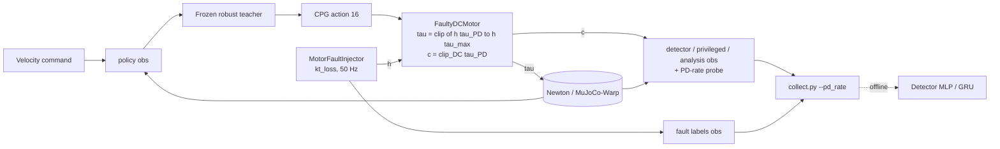

# Motor-degradation detector (A2 robust teacher)

**Gym IDs:** `IsaacContrib-FaultDetector-MotorDegrade-A2Robust` (play-only, data collection)
**Base:** `A2RobustTeacherEnvCfg` (`forge/velocity/a2_velocity`) with its runner cfg · **Uses:** `forge/fault_injector`
(`kt_loss`, imported, shared) · **Copied from:** `forge/fault_detector/motor_failure_detector` (observation terms,
recorded groups) · **Sources:** the user's request of 2026-10-26 (magnet / gear degradation, $h \in [0, 0.8]$, motor
current as measured on the robot)

## 1. Summary

The frozen A2 robust teacher walks its training terrain while one random joint loses torque constant from a random
onset on: $K_t = h\,K_{t,nom}$, $h \sim U[0, 0.8]$ ($h = 0$: the motor gives no torque). Gain and torque limit both
shrink by $h$; the drive's current reading does not, as its current loop still drives the current to the command.
The study (`scripts/forge/fault_detector`, README "kt_loss") repeats the v2 comparison on these data: MLP vs GRU at
0.5 false alarms / min, with and without the motor-current reading, joint- and leg-level success, trained and tested
on $h \le 0.6$ (A) and on $h \le 0.8$ (B).

## 2. Architecture

| Module | Rate [Hz] | Input → output | Notes |
|---|---|---|---|
| Policy | 50 | `policy` group (391) → CPG action (16) | robust teacher `model_2999`, deterministic |
| `MotorFaultInjector` | 50 | episode schedule → $h$ (12), current factor (12) | `kt_loss` only |
| `FaultyDCMotor` | 200 | $q^\ast, q, \dot q, h \to \tau$, current reading $c$ | Isaac Lab actuator path |
| Detector (offline) | 200 | window of 5 policy steps (20 samples) → $p_j$ (12), type (4) | trained on recorded episodes |

**Networks.**

| Network | Input (dim) | Layers | Output (dim) | Trained by |
|---|---|---|---|---|
| Actor (frozen) | `policy` (391) | robust teacher's | CPG action (16) | PPO (trained task) |
| Detector MLP | $20 \times 49$ (proprio) / $20 \times 61$ (+ current) | flatten (980 / 1220) → [256, 128], ELU | joint logits (12), type logits (4) | BCE + 0.5 CE |
| Detector GRU | $20 \times 49$ / $20 \times 61$ | GRU(→128, 1 layer), $h_0 = 0$ per window, last step | joint logits (12), type logits (4) | BCE + 0.5 CE |

One network per detector, not one per leg or joint: it outputs 12 joint logits at once (details in §3.4).

## 3. Method

### 3.1 Fault model (`kt_loss`)

$$\tau = \mathrm{clip}\big(h\,\tau_{PD},\ h\,\tau_{min}(\dot q),\ h\,\tau_{max}(\dot q)\big) = h\,\mathrm{clip}_{DC}(\tau_{PD}),
\qquad c = K_{t,nom}\, i = \mathrm{clip}_{DC}(\tau_{PD})$$

with $\tau_{PD} = K_p (q^\ast - q) - K_d \dot q$ ($K_p$ 100 / 100 / 150, $K_d$ 4 / 4 / 6 for hip / thigh / calf) and
the DC torque-speed limits $\tau_{max}(\dot q)$ (stall and limit 120 / 120 / 180 N·m). $h \sim U[0, 0.8]$ per
faulty episode; fault probability 0.7, joint uniform over 12, onset $U[2, 8]$ s (the injector's defaults).

### 3.2 Recorded observation groups (all noiseless)

As `motor_failure_detector` (`detector`, `privileged`, `analysis`, `fault`), plus `analysis/motor_current` (12) and,
with `collect.py --pd_rate`, `pd/motor_current`: the current reading $c$ of the previous PD substep, in articulation
order. The detector adds uniform noise of ±1 N·m to it (as to the torque reading of `tmp/explore.py`).

### 3.3 Environment changes from the base

| Change | Value | Why |
|---|---|---|
| Fault injector | `MotorFaultInjectorCfg(fault_types={"kt_loss": 1}, kt_loss_health=(0, 0.8))` | the user's request |
| Actuator path | `use_newton_actuators = False` | Newton-native actuators accept only stock classes |
| Terrain | the training grid, robots uniform over all levels, no curriculum | as `motor_failure_detector` |
| Disturbances | `push_robot`, `base_external_force_torque` off | abnormal motion comes from policy, terrain and fault |

### 3.4 Detectors (offline, `scripts/forge/fault_detector/detector.py`)

**Structure.** One network for the whole robot. It reads a window of the last 5 policy steps (100 ms) at the PD
rate, i.e. $L = 20$ samples $x_{t-19}, \dots, x_t$ (padded with the episode's first sample), and outputs 12 joint
logits $z_j$ (one per motor, $p_j = \sigma(z_j)$, independent sigmoids, so "no fault" is all $p_j$ low) and 4
fault-type logits (softmax; auxiliary loss only). There is no per-leg or per-joint network; legs enter only through
the reporting (leg of the argmax joint).

**Input per sample** (articulation joint order FL/FR/RL/RR × hip/thigh/calf), normalized with the train split's
mean / std, clipped to ±10, with uniform noise during training and evaluation:

| Term | Dim | Noise half-width | `proprio` | `proprio_current` |
|---|---|---|---|---|
| base angular velocity (base frame) | 3 | 0.2 rad/s | ✓ | ✓ |
| projected gravity | 3 | 0.05 | ✓ | ✓ |
| joint position − default | 12 | 0.01 rad | ✓ | ✓ |
| joint velocity | 12 | 1.5 rad/s | ✓ | ✓ |
| last action (CPG: 4 phase offsets + 12 residual targets) | 16 | 0 | ✓ | ✓ |
| velocity command | 3 | 0 | ✓ | ✓ |
| motor current $c = \mathrm{clip}_{DC}(\tau_{PD})$ of the previous substep [N·m] | 12 | 1.0 N·m | | ✓ |
| **per sample** | | | **49** | **61** |
| **per window** ($L = 20$) | | | **980** | **1220** |

**Networks.**

| | Layers | Parameters (`proprio` / `+ current`) | CPU, batch 1 |
|---|---|---|---|
| MLP | flatten $20 \times D$ → Linear 256 → ELU → Linear 128 → ELU → heads 12 + 4 | 286,096 / 347,536 | 0.05 ms |
| GRU | GRU($D$ → 128) over the 20 samples, $h_0 = 0$ per window, last hidden state → heads 12 + 4 | 70,800 / 75,408 | 0.34 ms |

**Alarm.** At every sample, alarm when $\max_j p_j > \tau$ has held for $k$ consecutive samples, armed 0.5 s after a
reset; the diagnosis is $\arg\max_j p_j$ at the alarm (its leg for the leg-level score). $\tau$ and
$k \in \{1, 4, 8, 12\}$ samples (0–60 ms) are set per run on the validation split: the lowest median latency at
≤ 0.5 false alarms / min (e.g. `kt_A` seed 0: MLP + current $\tau = 0.977$, $k = 4$; GRU proprio $\tau = 0.861$,
$k = 12$).

**Compared with the CJ detector of `tmp/explore.py`** (the live demo's earlier default): CJ also takes
proprioception, but as physics features and through a joint-shared network:

| | MLP / GRU (here) | CJ (`JointNet`, features `current`) |
|---|---|---|
| Per-joint input | raw terms above | 7 features per joint and sample: $q$, $\dot q$, $e = q^\ast - q$, $\tau_{PD} = \mathrm{clip}_{DC}(K_p e - K_d \dot q)$, $\ddot q$ (difference), $\tau_{meas}$, $\tau_{meas} - \tau_{PD}$ (previous substep) |
| Global input | inside the same vector | 25 per sample: base angular velocity, gravity, last action, command |
| Network | one network → 12 logits | context MLP [$20 \cdot 25 = 500$ → 128 → 64]; one joint network shared by the 12 joints: [own window $20 \cdot 7$ + its two leg mates' $2 \cdot 20 \cdot 7$ + context 64 + joint one-hot 12 = 496 → 128 → 64 → 1 logit] |
| Parameters | 286k–348k (MLP) | 145k |
| Torque reading | $c$ = the command (blind to $h$) | $\tau_{meas}$ = the applied torque $h\,\tau$ (a joint-torque sensor), so $\tau_{meas} - \tau_{PD} \approx (h - 1)\,\tau_{PD}$ shows $h$ directly |
| Alarm | debounce on $\max_j p_j$ | per-joint CUSUM on the logit |

## 4. Deviations

- **Torque-speed curve**: $\tau_{max}(\dot q)$ is the nominal DC curve scaled by $h$. A real $K_t$ loss also lowers
  the back-EMF constant, which would raise the no-load speed; the user's model scales the limit only.
- **$h = 0$ is a torque-constant loss, not a power cut**: the current reading still follows the command. A drive
  without power would read 0 (`power_out` of the injector); $h$ is drawn continuously, so exactly 0 never occurs.
- **Single fault type**: the type head (4 classes, shared with the other tasks' detectors) only separates nominal
  from `kt_loss` windows here.

## 5. Results

Details: `scripts/forge/fault_detector/README.md`, section "kt_loss". `test_id`, 0.5 false alarms / min (set on
validation), success = alarm on the right joint within 500 ms, mean of 3 seeds:

| Config | A: $h \le 0.6$ | B: $h \le 0.8$ |
|---|---|---|
| MLP · proprio | 0.760, median 213 ms | 0.642, 237 ms |
| GRU · proprio | 0.685, 287 ms | 0.585, 310 ms |
| MLP · proprio + motor current | **0.844, 153 ms** | **0.735, 178 ms** |
| GRU · proprio + motor current | 0.808, 190 ms | 0.691, 227 ms |

The current reading, blind to $h$, still adds 8–9 pt: it is the PD command, which carries the tracking error that
proprioception lacks. The MLP beats the GRU everywhere. Leg-level and joint-level success coincide (the diagnosis at
the alarm is right in 97–99 %). Weak faults dominate the misses: $h \in [0.6, 0.7)$ 0.43, $[0.7, 0.8)$ 0.22 (B, MLP +
current), against ≥ 0.94 for $h < 0.3$.

### Figures (`results/kt_A/figures`, `results/kt_B/figures`, `results/kt_compare`)

All on `test_id` with input noise, one curve per (architecture, inputs).

- **`matched_false_alarm.png`**: the trade-off between false alarms and detection. Each run's threshold $\tau$ and
  debounce $k$ are set on the validation split for four targets, 0.25 / 0.5 / 1 / 2 false alarms per minute; each
  point is one target, mean over the 3 seeds.
  - x: false alarms per minute measured on `test_id` (log scale; rising alarm edges in fault-free walking, before
    the onset or in nominal episodes). It lands near, not on, the target, since the threshold comes from validation.
  - y, left: success, the share of faults whose first alarm is on the right joint within 500 ms of the onset.
  - y, right: median latency [ms] from the onset to the first alarm, over the detected faults (misses excluded).
  - Reading: a curve higher on the left panel / lower on the right one is better at the same false-alarm rate;
    accepting more false alarms (to the right) buys success and latency. In B, MLP + current leads at every rate
    (0.69 → 0.79 success, 200 → 145 ms from 0.2 to 2 / min); the GRU without current trails.
- **`reliability.png`**: calibration of the joint probabilities (reliability diagram), first seed of each config.
  Every (sample, joint) probability $p_j$ past the first 0.5 s of an episode is put in one of 10 bins of width 0.1.
  - x: the mean predicted probability $p_j$ in the bin.
  - y: the observed fault frequency in the bin, the share of those (sample, joint) pairs whose joint is faulty.
  - Reading: on the diagonal, $p_j = 0.7$ means faulty 70 % of the time. All four configs lie slightly above it in
    the middle (B: $p_j \approx 0.45 \to$ 55–59 % faulty): mid-range probabilities understate the fault rate. A likely
    cause (not tested): windows right after an onset are labeled faulty but still look nominal, and the training
    leaves them out of the loss (80 ms grace). Almost all pairs sit at $p_j \approx 0$ or $1$, so the expected
    calibration error stays at 0.0012–0.0023. Calibration does not move the matched-false-alarm results, which only rank probabilities.
- `confusion.png`: row-normalized 12 × 12 joint and 4 × 4 leg confusion of the argmax over faulty windows (seeds
  summed); `accuracy_since_onset.png`: argmax joint accuracy against the time since the onset (0–100, 100–200,
  200–500, 500–1000, > 1000 ms); `kt_compare/success_compare.png`: success against measured false alarms for A and
  B together (MLP + current), joint-level (left) and leg-level (right); the two panels are nearly identical, as the
  diagnosis at the alarm is almost always right.
- **`debounce/debounce.png`** (`experiment.py debounce <exp>`): the $(\tau, k)$ trade-off. The main results pick
  the best $k$ per run; here every $k \in \{1, 4, 8, 12\}$ samples (0 / 20 / 40 / 60 ms) is kept, $\tau$ set on
  validation for it alone at each false-alarm target, and scored on `test_id` (mean of 3 seeds). One column per
  config, one curve per $k$.
  - x: false alarms per minute measured on `test_id` (log).
  - y, rows: success (right joint ≤ 500 ms), median latency of the detected faults [ms], and the threshold $\tau$
    that validation gave for that $k$.
  - $\tau$ is searched in $[0.5, 1)$; where a long debounce already meets a loose target at $\tau = 0.5$ the point
    lands left of it (e.g. MLP + current, $k = 12$, 2 / min → 1.2 / min).

  At 0.5 false alarms / min (`debounce/debounce.md`; $\tau$ / success / median latency):

  | Config | $k = 1$ | $k = 4$ | $k = 8$ | $k = 12$ |
  |---|---|---|---|---|
  | A, MLP + current | 0.998 / 0.825 / 158 ms | 0.981 / 0.844 / 153 ms | 0.923 / 0.844 / 163 ms | 0.799 / 0.841 / 175 ms |
  | A, MLP | 0.998 / 0.741 / 213 ms | 0.983 / 0.756 / 212 ms | 0.931 / 0.762 / 220 ms | 0.836 / 0.757 / 235 ms |
  | A, GRU + current | 0.989 / 0.755 / 213 ms | 0.959 / 0.800 / 192 ms | 0.898 / 0.815 / 188 ms | 0.828 / 0.804 / 202 ms |
  | A, GRU | 0.982 / 0.616 / 318 ms | 0.930 / 0.681 / 282 ms | 0.868 / 0.685 / 285 ms | 0.785 / 0.686 / 295 ms |
  | B, MLP + current | 0.996 / 0.712 / 178 ms | 0.972 / 0.730 / 177 ms | 0.887 / 0.739 / 183 ms | 0.746 / 0.736 / 195 ms |
  | B, MLP | 0.995 / 0.631 / 237 ms | 0.967 / 0.645 / 237 ms | 0.896 / 0.653 / 248 ms | 0.773 / 0.650 / 262 ms |
  | B, GRU + current | 0.981 / 0.641 / 253 ms | 0.940 / 0.682 / 230 ms | 0.873 / 0.697 / 227 ms | 0.786 / 0.696 / 238 ms |
  | B, GRU | 0.970 / 0.527 / 333 ms | 0.908 / 0.572 / 308 ms | 0.820 / 0.585 / 303 ms | 0.733 / 0.581 / 315 ms |

  - **No debounce ($k = 1$) is the worst everywhere**: single-sample spikes of $\max_j p_j$ (per-sample input noise,
    foot strikes, terrain edges) force $\tau$ to 0.97–0.998, costing 2–3 pt of success against the best $k$ for the
    MLP and 5.5–7 pt for the GRU, whose outputs spike more.
  - **20–40 ms is the sweet spot**: $k = 4$ gives the lowest (or equal) latency for the MLP; $k = 8$ adds ≤ 1 pt of
    success for 6–11 ms; $k = 12$ lets $\tau$ drop to 0.73–0.84 but adds latency without more success.
  - **The debounce trades against $\tau$**: each step of $k$ lowers the threshold the same false-alarm rate needs
    (A, MLP + current: 0.998 → 0.981 → 0.923 → 0.799); the latency moves by only 20–40 ms across $k$, as the lower
    threshold is crossed earlier while the debounce adds back $(k - 1) \times 5$ ms.
  - Check: the $k$ each run picked in the main results reproduces its numbers (A, MLP + current: $k = 4$ for all
    seeds, 0.844 / 153 ms in both tables).

## 6. Changelog

- 2026-10-26: First version. Reason: the user's request to model magnet / gear degradation with the gain and torque
  limit both scaled by $h \in [0, 0.8]$ and a motor current as read on the robot.
- 2026-10-26: §3.4 detector structure, input dimensions, alarm rule and the comparison with CJ. Reason: the user's
  question whether the detectors are per leg and what they read.
- 2026-10-26: figure descriptions and the $(\tau, k)$ debounce comparison (`experiment.py debounce`). Reason: the
  user's questions on the figures and on why a 4-sample debounce.
