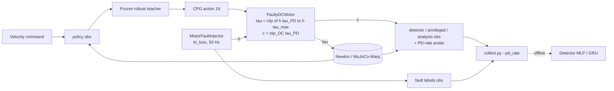

# Motor-degradation detector (A2 robust teacher)

**Gym IDs:** `IsaacContrib-FaultDetector-MotorDegrade-A2Robust` (play-only, data collection)
**Base:** `A2RobustTeacherEnvCfg` (`forge/velocity/a2_velocity`) with its runner cfg · **Uses:** `forge/fault_injector`
(`kt_loss`, imported, shared) · **Copied from:** `forge/fault_detector/motor_failure_detector` (observation terms,
recorded groups) · **Sources:** the user's request of 2026-10-26 (magnet / gear degradation, $h \in [0, 0.8]$, motor
current as measured on the robot)

## 1. Summary

The frozen A2 robust teacher walks its training terrain while one random joint loses torque constant from a random
onset on: $K_t = h\,K_{t,nom}$, $h \sim U[0, 0.8]$ ($h = 0$: the motor gives no torque). Gain and torque limit both
shrink by $h$; the drive's current reading does not, as its current loop still drives the current to the command.
The study (`scripts/forge/fault_detector`, README "kt_loss") repeats the v2 comparison on these data: MLP vs GRU at
0.5 false alarms / min, with and without the motor-current reading, joint- and leg-level success, trained and tested
on $h \le 0.6$ (A) and on $h \le 0.8$ (B).

## 2. Architecture

| Module | Rate [Hz] | Input → output | Notes |
|---|---|---|---|
| Policy | 50 | `policy` group (391) → CPG action (16) | robust teacher `model_2999`, deterministic |
| `MotorFaultInjector` | 50 | episode schedule → $h$ (12), current factor (12) | `kt_loss` only |
| `FaultyDCMotor` | 200 | $q^\ast, q, \dot q, h \to \tau$, current reading $c$ | Isaac Lab actuator path |
| Detector (offline) | 200 | window of 5 policy steps (20 samples) → $p_j$ (12), type (4) | trained on recorded episodes |

**Networks.**

| Network | Input (dim) | Layers | Output (dim) | Trained by |
|---|---|---|---|---|
| Actor (frozen) | `policy` (391) | robust teacher's | CPG action (16) | PPO (trained task) |
| Detector MLP | $20 \times 49$ (proprio) / $20 \times 61$ (+ current) | flatten → [256, 128], ELU | joint logits (12), type logits (4) | BCE + 0.5 CE |
| Detector GRU | $20 \times 49$ / $20 \times 61$ | GRU(→128, 1 layer), $h_0 = 0$ per window, last step | joint logits (12), type logits (4) | BCE + 0.5 CE |

## 3. Method

### 3.1 Fault model (`kt_loss`)

$$\tau = \mathrm{clip}\big(h\,\tau_{PD},\ h\,\tau_{min}(\dot q),\ h\,\tau_{max}(\dot q)\big) = h\,\mathrm{clip}_{DC}(\tau_{PD}),
\qquad c = K_{t,nom}\, i = \mathrm{clip}_{DC}(\tau_{PD})$$

with $\tau_{PD} = K_p (q^\ast - q) - K_d \dot q$ ($K_p$ 100 / 100 / 150, $K_d$ 4 / 4 / 6 for hip / thigh / calf) and
the DC torque-speed limits $\tau_{max}(\dot q)$ (stall and limit 120 / 120 / 180 N·m). $h \sim U[0, 0.8]$ per
faulty episode; fault probability 0.7, joint uniform over 12, onset $U[2, 8]$ s (the injector's defaults).

### 3.2 Recorded observation groups (all noiseless)

As `motor_failure_detector` (`detector`, `privileged`, `analysis`, `fault`), plus `analysis/motor_current` (12) and,
with `collect.py --pd_rate`, `pd/motor_current`: the current reading $c$ of the previous PD substep, in articulation
order. The detector adds uniform noise of ±1 N·m to it (as to the torque reading of `tmp/explore.py`).

### 3.3 Environment changes from the base

| Change | Value | Why |
|---|---|---|
| Fault injector | `MotorFaultInjectorCfg(fault_types={"kt_loss": 1}, kt_loss_health=(0, 0.8))` | the user's request |
| Actuator path | `use_newton_actuators = False` | Newton-native actuators accept only stock classes |
| Terrain | the training grid, robots uniform over all levels, no curriculum | as `motor_failure_detector` |
| Disturbances | `push_robot`, `base_external_force_torque` off | abnormal motion comes from policy, terrain and fault |

## 4. Deviations

- **Torque-speed curve**: $\tau_{max}(\dot q)$ is the nominal DC curve scaled by $h$. A real $K_t$ loss also lowers
  the back-EMF constant, which would raise the no-load speed; the user's model scales the limit only.
- **$h = 0$ is a torque-constant loss, not a power cut**: the current reading still follows the command. A drive
  without power would read 0 (`power_out` of the injector); $h$ is drawn continuously, so exactly 0 never occurs.
- **Single fault type**: the type head (4 classes, shared with the other tasks' detectors) only separates nominal
  from `kt_loss` windows here.

## 5. Results

Details: `scripts/forge/fault_detector/README.md`, section "kt_loss". `test_id`, 0.5 false alarms / min (set on
validation), success = alarm on the right joint within 500 ms, mean of 3 seeds:

| Config | A: $h \le 0.6$ | B: $h \le 0.8$ |
|---|---|---|
| MLP · proprio | 0.760, median 213 ms | 0.642, 237 ms |
| GRU · proprio | 0.685, 287 ms | 0.585, 310 ms |
| MLP · proprio + motor current | **0.844, 153 ms** | **0.735, 178 ms** |
| GRU · proprio + motor current | 0.808, 190 ms | 0.691, 227 ms |

The current reading, blind to $h$, still adds 8–9 pt: it is the PD command, which carries the tracking error that
proprioception lacks. The MLP beats the GRU everywhere. Leg-level and joint-level success coincide (the diagnosis at
the alarm is right in 97–99 %). Weak faults dominate the misses: $h \in [0.6, 0.7)$ 0.43, $[0.7, 0.8)$ 0.22 (B, MLP +
current), against ≥ 0.94 for $h < 0.3$.

## 6. Changelog

- 2026-10-26: First version. Reason: the user's request to model magnet / gear degradation with the gain and torque
  limit both scaled by $h \in [0, 0.8]$ and a motor current as read on the robot.
