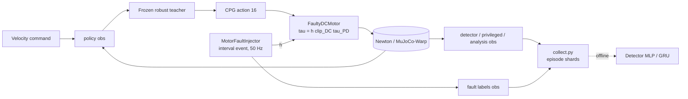

# Motor-failure detector (A2 robust teacher)

**Gym IDs:** `IsaacContrib-FaultDetector-MotorFailure-A2Robust` (play-only, data collection)
**Base:** `A2RobustTeacherEnvCfg` (`forge/velocity/a2_velocity`) with its runner cfg · **Uses:** `forge/fault_injector`
(imported, shared) · **Sources:** the user's spec "Fault Detector Spec — Motor Power Loss Injector & MLP/GRU
Predictor" (2026-10-25); Hou et al., ICRA 2024 (MTL); Turrisi et al., 2026 (MoE)

## 1. Summary

The frozen A2 robust teacher walks its training terrain while `forge/fault_injector` cuts the power of one random
joint (power out, $h = 0$) or scales its torque (power loss, $h \in [0.1, 0.6]$) from a random onset on. Every policy
step's noiseless proprioception, privileged state and labels are recorded; a detector (MLP or GRU, ~70k parameters,
history $H = 3$) is trained offline to output one fault probability per joint. The study compares MLP vs GRU (Q1) and
proprioception vs proprioception + privileged base state (Q2), and analyzes latency per fault type, joint and gait
phase (Q3). Code: `scripts/forge/fault_detector` (see its README for usage and the decisions taken).

## 2. Architecture

| Module | Rate [Hz] | Input → output | Notes |
|---|---|---|---|
| Policy | 50 | `policy` group (391) → CPG action (16) | robust teacher `model_2999`, deterministic |
| `MotorFaultInjector` | 50 | episode schedule → $h$ (12) | after resets, before observations |
| `FaultyDCMotor` | 200 | $q^\ast, q, \dot q, h \to \tau$ | Isaac Lab actuator path (`use_newton_actuators = False`) |
| Detector (offline) | 50 | window $[o_{t-2}, o_{t-1}, o_t]$ → $p_j$ (12), type (3) | trained on recorded episodes |

**Networks.**

| Network | Input (dim) | Layers | Output (dim) | Trained by |
|---|---|---|---|---|
| Actor (frozen) | `policy` (391) | robust teacher's | CPG action (16) | PPO (trained task) |
| Detector MLP | $3 \times 49$ (proprio) / $3 \times 52$ (+priv) | flatten → [256, 128], ELU | joint logits (12), type logits (3) | BCE + 0.5 CE |
| Detector GRU | $3 \times 49$ / $3 \times 52$ | GRU(→128, 1 layer), $h_0 = 0$ per window, last step | joint logits (12), type logits (3) | BCE + 0.5 CE |

## 3. Method

### 3.1 Recorded observation groups (all noiseless)

| Group | Terms (dim) | Use |
|---|---|---|
| `detector` | base_ang_vel (3), projected_gravity (3), joint_pos_rel (12), joint_vel (12), last_action (16), velocity_command (3) | detector input (49) |
| `privileged` | base_height above terrain (1), base_lin_vel in base frame (3; x, y used) | Q2 input (+3) |
| `analysis` | joint_pos_target_rel (12), imu_lin_acc $a - g$ in base frame (3), foot_contact (4), foot_contact_force (12), applied_torque (12) | analysis only, never an input |
| `fault` | injector labels (28) | supervision |

### 3.2 Environment changes from the base

| Change | Value | Why |
|---|---|---|
| Fault injector | `MotorFaultInjectorCfg()` defaults (README of `forge/fault_injector`) | the spec's distribution |
| Actuator path | `use_newton_actuators = False` | Newton-native actuators accept only stock classes |
| Terrain | the training grid (10 levels × 20 columns, 8 families), robots uniform over all levels, no curriculum | the policy's own distribution (see Deviations) |
| Disturbances | `push_robot`, `base_external_force_torque` off | abnormal motion comes from policy, terrain and fault |
| Terminations | base contact, tilt > 1 rad, time-out 20 s (the base's) | |

### 3.3 Detector

Input at step $t$: $x_t = [o_{t-2}, o_{t-1}, o_t]$, padded with the episode's first observation, normalized with the
train split's mean / std and clipped to $\pm 10$. Training adds uniform noise to proprioception (half-widths: ang vel
0.2, gravity 0.05, joint pos 0.01, joint vel 1.5; none on actions, commands, privileged terms).

$$L = \frac{1}{12}\sum_j \mathrm{BCE}(\sigma(z_j), m_j) + 0.5\,\mathrm{CE}(\mathrm{softmax}(z^{type}), c)$$

Sampling: 50 % nominal windows, 50 % faulty windows split equally over the 24 (joint, type) pairs, windows in
$[t_0, t_0 + 25)$ weighted ×4, the first 0.5 s of each episode excluded. AdamW (lr 1e-3, wd 1e-4), batch 4096,
2M windows per epoch, ≤ 30 epochs with cosine decay, clip 1.0, early stop on val macro-F1 (patience 5).

Alarm rule (closed loop): $\max_j p_j > \tau$ for $k$ consecutive steps, armed 0.5 s after each reset; diagnosis =
$\arg\max_j p_j$ at the alarm. Default $\tau = 0.5$, $k = 2$; sweep $\tau \in \{0.3, 0.5, 0.7, 0.9\} \times
k \in \{1, 2, 3\}$.

## 4. Deviations

- **Terrain: the training grid only** (the user's instruction of 2026-10-25: one environment, the training terrain or
  `forge/terrain` `rough_field`, whichever is more objective). The training grid is the policy's own distribution,
  so falls and abnormal motion are caused by the fault rather than by unseen terrain; `rough_field` would mix
  fault effects with out-of-distribution terrain. Consequently the spec's harsh-world OOD set is dropped;
  `test_ood` keeps only the weaker power loss ($h \in [0.6, 0.8]$).
- **Action dim 16, not 12**: the robust teacher's action is CPG phase offsets (4) + residual joint targets (12);
  `last_action` is the raw 16-dim action, so the proprio step is 49-dim (spec: 45).
- **Policy observation noise**: the teacher was trained without noise (`enable_corruption = False`), so it runs
  noiseless; the detector's training noise uses Isaac Lab's velocity-task policy-noise scales.
- **Closed loop = replay of whole held-out episodes**: the detector never acts on the controller, so running it inside
  the sim at every step is exactly per-step inference over the recorded episode with the same padding. Replaying lets
  one rollout (`test_id`, 2048 episodes) serve all 12 detectors and the whole threshold sweep.
- **Not implemented** (deferred by the spec or not needed for the 2 × 2): health head, `softmax13` head, stateful GRU,
  energy-policy swap, `proprio_privnoisy`, power-out videos.

## 5. Results

Details and the full analysis: `scripts/forge/fault_detector/README.md` (Results). Closed loop on `test_id`,
$\tau = 0.5$, $k = 2$, mean of 3 seeds:

| Config ($H = 3$) | Top-1 joint | Median latency [step] | False alarm / min |
|---|---|---|---|
| MLP · proprio | 0.794 | 6 | 8.1 |
| GRU · proprio | 0.773 | 7 | 8.5 |
| MLP · proprio_priv | 0.807 | 6 | 6.8 |
| GRU · proprio_priv | 0.781 | 7 | 7.6 |

The MLP beats the window GRU on every metric; privileged base state helps little. Power out is detected in a
median of 4 steps, power loss in 10. False alarms come from terrain transients and grow with terrain difficulty;
a longer history (H = 10, 25) improves identification (top-1 0.87, 0.92) but not the latency at a matched
false-alarm rate.

Actuator-path check: with faults off, 512 robots fell 31 times in their first 20 s episode with this task's Isaac Lab
DC motor vs 34 times with the training setup's Newton-native one (same seed, same per-level pattern).

## 6. Changelog

- 2026-10-25: First version and results v1 (2 × 2 × 3 seeds, history ablation H = 10, 25). Reason: the user's spec.
