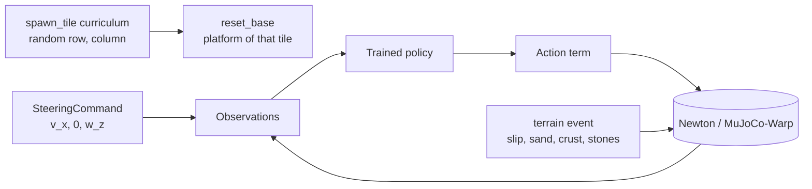

# Surveillance: A2 deployment on terrain maps

**Gym IDs:** `IsaacContrib-Surveillance-<Type>-{Robust,Energy}`, `<Type>` as in `forge/terrain` plus `slip_field` (20 tasks)
**Base:** `A2RobustTerrainEnvCfg`, `A2EnergyTerrainEnvCfg` (`forge/terrain`), with the trained tasks' runner cfgs ·
**Copied from:** `isaaclab.envs.mdp.reset_root_state_uniform` (`mdp/events.py`) · **Sources:** the user's request of 2026-10-25

## 1. Summary

Play-only deployment of the trained A2 robust teacher and energy (rough) policies on one terrain type, for
collecting falls (`scripts/forge/surveillance/campaign.py`). Differences from the terrain-map tasks: only the
map's difficulty rows 1–3, 20 robots that start every episode on a random tile, forward-only steering commands, and
an event trigger per terrain type (§3.3). `slip_field` adds `forge/terrain`'s random slips to `rough_field` (§3.4).
On the inclines (`rough_slope`, `rough_stairs`, `slip_slope`) the robots instead face straight up or down the slope
and get no turn command.

## 2. Architecture

| Module | Rate | What it does |
| --- | --- | --- |
| `spawn_tile` (curriculum) | every reset | draws the episode's tile, before the reset events place the robot |
| `SteeringCommand` | 50 Hz | forward speed and a smoothed yaw rate that turns by a random angle, then stops |
| `event_trigger` (cfg field) | 50 Hz, read by `collect.py` | whether the terrain event acts on each robot (§3.3) |
| Policy, actuators, terrain event | unchanged | the terrain-map task's |

Networks: the trained tasks' (unchanged).

## 3. Method

### 3.1 Steering command (robust policy)

Every segment of `U(5, 10)` s draws $v_x \sim U(0.5, 1.0)$ m/s, $v_y = 0$, and a turn
$\Delta\psi \sim U(-\pi/4, \pi/4)$. Each step, with the measured world yaw rate $\omega_z$ and $\Delta t = 0.02$ s:

$$\Delta\psi_{rem} \leftarrow \Delta\psi_{rem} - \omega_z \Delta t, \qquad
\omega^{des} = \begin{cases} \mathrm{clip}(k\,\Delta\psi_{rem}, \pm 0.6) & \text{turning} \\ 0 & \text{else} \end{cases}, \qquad
\omega^{cmd} \leftarrow \omega^{cmd} + \frac{\Delta t}{\tau + \Delta t}(\omega^{des} - \omega^{cmd})$$

with $k = 1$ /s, $\tau = 0.5$ s; turning ends for the segment once $|\Delta\psi_{rem}| < 2°$. The command is zeroed at
an episode reset. On the inclines $\Delta\psi = 0$: $\omega^{cmd} = 0$, the robot walks the way it faces. The
energy policy has no command input (fixed 0.9 m/s forward) and keeps its own command.

### 3.2 Map and spawn

The terrain map keeps the first 3 of its 5 rows at the full map's difficulties: $d = 0.4, 0.55, 0.7$ (inclines
0, 11.25, 22.5°), 5 tiles per row. `spawn_tile` draws row and column uniformly per reset and moves the robot's env
origin there; the robot spawns on that tile's platform (`reset_base`, offset and yaw as in `forge/terrain`). On the
inclines, which rise along $+x$, the yaw is $U(\pm 15°)$ plus $\pi$ for half of the resets
(`reset_root_up_or_down`, copied from Isaac Lab's `reset_root_state_uniform`): the robot faces up or down the slope.

### 3.3 Event triggers

`event_trigger` (`mdp/triggers.py`) is a function `env -> bool [num_envs]`. It reads the state of `forge/terrain`'s
terrain event term, which is one policy step old when the recorder reads it. `scripts/forge/surveillance/collect.py
--max_triggers` saves a 5 s window centered on each rising edge, apart from the falls (`triggers/`):

| Terrain | Trigger | True when |
| --- | --- | --- |
| `crust_collapse` | `crust_collapse` | `collapse_event`: the crust patch under one of the robot's feet collapsed in the last step |
| `sand_field` | `sand_sink` | `in_sand`: a foot below the surface of a soft patch (ordinary sand or collapsed crust) |
| `gravel_field` | `stone_step` | a foot with vertical force > 1 N, within half the length of one of its robot's stones (horizontally) and > 2 cm above the ground height map plus the foot radius |
| `slip_slope`, `slip_field` | `foot_slip` | `low_mu` and vertical force > 1 N on the same foot: it touched down with a low friction (§3.4). The trigger moment is the slippery touchdown, whether or not the foot then slides |
| the others | `random_walk` | at random, $p = \Delta t / 5$ s per step and robot: normal walking, no event |

### 3.4 Slips, `slip_field`

Slips follow `forge/terrain`'s default since 2026-10-26. Each foot on slip terrain draws its friction at every
touchdown: with probability `slip_prob` 0.02, $\mu \sim U(lo(d), hi(d))$, else $\mu_{nominal}$ 0.8. The range is
$lo = 0.05 \to 0.03$ and $hi = 0.35 \to 0.25$ over $d = 0 \to 1$, which gives 0.042–0.31, 0.039–0.295, 0.036–0.28
on rows 1–3. A slip lasts one stance: the next touchdown restores 0.8 with probability 0.98. At about 2 touchdowns
per foot and second, that is roughly one slip per robot every 6 s. The ground's own $\mu$ is 0.02, and MuJoCo uses
the larger of the two. The policy's privileged friction input still reports 0.8 (`observe_slip` False).
`terrain_v1` (§5.1) ran with the old default: 75 % of the feet low, drawn once per episode.

`slip_field` = `RoughFieldCfg(zone="slip")`, added to the world's template catalog by this task (`extra_templates`,
registered through `EXTRA_TERRAINS`). It is rough_field's ground with the slip event, at the same difficulties (0.4,
0.55, 0.7). Tile layouts are seeded by the terrain name, so its tiles differ from `rough_field`'s. It is not an
incline: steering with turns, as on the other flat types.

## 4. Deviations

Values the request does not fix:

* $v_x$ range 0.5–1.0 m/s (forward only, inside the trained −0.5–1.5 m/s).
* Yaw-rate limit 0.6 rad/s, $k = 1$ /s, $\tau = 0.5$ s, 2° tolerance: a 45° turn takes about 2 s without a step in
  $\omega^{cmd}$. The turned angle is integrated from the measured yaw rate rather than read from the heading, so it
  needs no heading at the reset step and no angle wrapping.
* The spawn tile is drawn in a curriculum term: Isaac Lab runs the curriculum before the reset events, so the
  robot is placed on the new tile in the same reset.
* `stone_step` uses the stones' circle bound and the height above the ground map rather than the contact partner:
  the contact sensor reports net forces only. It reads the terrain event's private stone lengths (`_rock_sizes`).
* Built on `forge/terrain`'s env cfgs and `TERRAINS` (not copied): the terrain maps are shared infrastructure, and a
  copy would drift from the maps the falls are analyzed on.

## 5. Results

### 5.1 Campaign `terrain_v1` (2026-10-25)

**Setup.** `campaign.py enqueue --name terrain_v1`, run before the move to `forge/surveillance`: the same task code
as now (gym IDs then `IsaacContrib-Velocity-A2Deploy-*`, incline fix included) but **20 robots** and a cap of **200
falls**. Robust teacher `a2_robust_teacher_s0/model_2999`, energy teacher rough `a2_energy_teacher_rough_s0/model_2999`,
terrain seed 42, Euler RTX 4090, Newton/MJWarp. Each play: 30 min sim or 200 base-contact falls, then up to 10 videos
of falls evenly spread over sim time. Data: Euler `logs/fault_analysis/terrain_v1/<Policy>/<terrain>`, local
`results/euler/isaaclab3/fault_analysis/terrain_v1` (2.1 GB; `report.md` there has every row). Success = an episode
that ends by leaving its tile or by the 60 s time-out; level 1–3 = d 0.4 / 0.55 / 0.7 (inclines 0 / 11.25 / 22.5°).

| Policy | Terrain | Success L1 / L2 / L3 | Falls | Mean time to fall [s] | Episodes | Sim / wall [min] | Videos |
| --- | --- | --- | --- | --- | --- | --- | --- |
| Robust | slip_slope | 0.826 / 0.797 / 0.771 | **200** | 13.2 | 989 | 18.9 / 6.5 (cap) | 10 |
| Robust | gravel_field | 0.966 / 0.964 / 0.972 | 59 | 12.0 | 1809 | 30 / 17.3 | 10 |
| Robust | rough_slope | 1 / 1 / 0.998 | 1 | 9.5 | 1847 | 30 / 8.5 | 1 |
| Robust | rough_field, pit_field, stub_field, rough_stairs, sand_field, crust_collapse | 1 / 1 / 1 | 0 | – | 1783–1867 each | 30 / 8.3–10.5 | 0 |
| Energy | slip_slope | 0.963 / 0.963 / 0.935 | 109 | 8.6 | 2333 | 30 / 11.1 | 10 |
| Energy | pit_field | 0.996 / 0.971 / 0.939 | 24 | 31.7 | 747 | 30 / 8.7 | 10 |
| Energy | rough_stairs | 1 / 1 / 0.968 | 12 | 12.4 | 1068 | 30 / 8.8 | 8 |
| Energy | gravel_field | 1 / 0.987 / 0.978 | 8 | 33.0 | 703 | 30 / 17.0 | 7 |
| Energy | rough_field | 1 / 1 / 0.976 | 6 | 20.7 | 716 | 30 / 8.7 | 5 |
| Energy | rough_slope | 1 / 1 / 0.995 | 2 | 19.5 | 1113 | 30 / 8.8 | 2 |
| Energy | sand_field, crust_collapse, stub_field | 1 / 1 / 1 | 0 | – | 600–601 each | 30 / 8.3–10.5 | 0 |

Only Robust/slip_slope reached the fall cap; every other play ran the full 30 min. Fewer than 10 videos means
fewer falls with a full 5 s window.

**Findings.**

1. **The robust teacher only falls on `slip_slope`** (and on `gravel_field`, see 3): at levels 1–3 it crossed every
   tile of the six rigid and sand types and of `rough_stairs` (up to 22.5°) without a fall in 9 robot-hours each.
   On `slip_slope` its success rate drops with the slope (0.83 → 0.77, 18–30° slopes at μ 0.03–0.35 under 75 % of
   the feet).
2. **The energy policy walks in circles.** It has no command or heading input, and in its saved windows its base
   turns at 0.4–0.6 rad/s at 0.7–0.9 m/s, a circle of about 1.5 m radius. On flat ground it therefore stays on its
   tile until the 60 s time-out (`stub_field`: 600 of 600 episodes; `sand_field`, `crust_collapse`: 96 %), so its
   success there means "did not fall while circling", not "crossed the tile". On inclines gravity pulls it off the
   tile (mean episode 15–23 s). Its falls are not comparable with the robust teacher's for that reason.
3. **Robust falls on `gravel_field` are base hits, not tip-overs.** Of 59 falls, only 1 has `A_tilt`, none
   `A_low_base`; in the last second 53 % have `C_sinking` (a stance foot dropped 2 cm: a stepped-on stone tilting)
   and 14 % `C_trip`, against 2 % and 0 % 4–5 s earlier. With stones up to 45 cm, the base touches a stone while
   upright. Whether that should count as a failure is open; `--terminations` can change it.
4. **`slip_slope`, robust (200 falls), last second vs. 4–5 s before:** `A_tilt` 98.5 vs 18.7 %, `B_value_drop` 60.5
   vs 1.0 %, `B_impact` 66 vs 5.7 %, `E_torque_saturation` 51 vs 15.5 %, `D_no_progress` 26 vs 0 %, `A_low_base` 48
   vs 0 %. `C_slip` is only 4 vs 4 %: its threshold comes from walking on the same slippery map (the baseline),
   so sliding is "normal" there. 115 of the 200 falls faced down the slope, 85 up.
5. **`slip_slope`, energy (109 falls):** `C_flight` 76 %, `A_low_base` 88 %, `D_tracking` 70 % in the last second
   (0–12 % before): it slides and drops rather than tipping while walking; 68 falls faced up the slope, 41 down.
   Its `rough_stairs` falls (12) are all at 22.5°, 9 of them descending.

**Rule flags** (`analyze.py`, written into each collection as `flags.csv` / `thresholds.json`) were computed for
Robust `slip_slope` and `gravel_field` (baseline: both) and Energy `slip_slope`, `pit_field`, `rough_stairs`
(baseline: all five Energy collections with falls), frames ≥ 2 s before the fall as normal walking.

**Caveats.** `B_support` never hits on this data (0 % everywhere): the rule needs a check. Baselines come from the
fall windows themselves, so a terrain's normal behavior (sliding on `slip_slope`) does not flag. Level 1 of the
inclines is flat (0°). The heading split counts the heading 5 s before the fall.

### 5.2 Campaign `v2` (2026-10-26, event triggers)

**Setup.** `campaign.py enqueue --name v2` after the smoke test `smoke_trig` (Robust, 4 terrains, 1 min; all four
triggers saved full 250-frame windows). The current task: 10 types (`slip_field` added), 20 robots, 10 min sim or
100 falls, 100 trigger windows, 10 + 10 videos. Same checkpoints, seed 42, Euler RTX 4090. All 20 plays ran the full
10 min (3.33 robot-h each); the campaign took 2 h 24 min wall (collect 3.0–5.9 min and render 3.3–4.1 min per job).
Data: Euler `logs/surveillance/v2`, local `results/euler/isaaclab3/surveillance/v2` (3.1 GB). Full analysis, figures
and slides: `analysis/report.md`, `analysis/v2_slides.pptx` there.

| Policy | Terrain | Success L1 / L2 / L3 | Falls | Falls / robot-h (95 % CI) | Episodes |
| --- | --- | --- | --- | --- | --- |
| Robust | gravel_field | 0.99 / 0.995 / 0.995 | **4** | 1.20 (0.32–3.07) | 597 |
| Robust | rough_field, rough_slope | 1 / 1 / 0.995–0.996 | 1 each | 0.30 (0–1.67) | 594, 605 |
| Robust | the other 7 | 1 / 1 / 1 | 0 | 0 (0–1.10) | 582–612 each |
| Energy | pit_field | 0.988 / 1 / 0.925 | **8** | 2.40 (1.03–4.73) | 251 |
| Energy | gravel_field | 1 / 0.976 / 0.96 | **5** | 1.50 (0.48–3.50) | 223 |
| Energy | rough_field | 1 / 1 / 0.957 | **4** | 1.20 (0.32–3.07) | 232 |
| Energy | rough_slope, rough_stairs | 1 / 1 / 0.992–0.993 | 1 each | 0.30 (0–1.67) | 384, 344 |
| Energy | stub_field, slip_slope, sand_field, crust_collapse, slip_field | 1 / 1 / 1 | 0 | 0 (0–1.10) | 200–659 each |

**Findings.**

1. **Fall rates:** Robust 6 falls in 33.3 robot-h (0.18 / robot-h, success 0.999), 4 of them upright base hits on
   gravel stones (tilt 4–11°); Energy 19 (0.57 / robot-h, success 0.994), 16 on level 3, mostly sideways roll-overs
   on `pit_field` / `rough_field` (tilt 121–175°). The three incline falls are all forward pitches descending the
   22.5° row.
2. **No falls on `slip_slope` / `slip_field`** with the 2 %-per-touchdown slips (§3.4); `terrain_v1` had 200
   (Robust) and 109 (Energy) on `slip_slope` with 75 % of the feet slippery for the whole episode.
3. **The triggers act on the robot.** Median max stance-foot speed in the 1 s after vs. a 1 s before (Robust):
   `random_walk` 1.0×, `foot_slip` 1.5×, `stone_step` 1.7×, `sand_sink` 2.4×, `crust_collapse` 2.7×; windows with a
   leg contact after a sand / crust trigger 90 / 88 % (before 29 / 13 %). No trigger window ended in a fall.
4. Robust `gravel_field` fell at 1.2 / robot-h against 5.9 in `terrain_v1`; not explained by a known change (wide
   CI with 4 falls). Energy `pit_field` matches `terrain_v1` (2.4 / robot-h).

**Caveats.** `render.py` replays the robot only: the dynamic stones and the sand / crust sinking are not in the
videos, so trigger effects are read from the data. Trigger window counts are paced, not natural rates. Energy's
success on flat types is time-outs while circling (as in §5.1).

## 6. Changelog

- 2026-10-26: New terrain type `slip_field` (rough_field + slips), 10 types; trigger `foot_slip` on `slip_slope`
  and `slip_field`. Slips now come from `forge/terrain`'s new default (2 % per touchdown, one stance long), not an
  override here. Reason: the user's request.
- 2026-10-26: 20 robots; `event_trigger` per terrain type (`mdp/triggers.py`: crust collapse, sand sinking, stone
  step, random normal walking). Reason: the user's request (check that the terrain events fire, apart from the falls).
- 2026-10-26: Moved from `forge/velocity/a2_deploy` to `forge/surveillance` (gym IDs `IsaacContrib-Velocity-A2Deploy-*` → `IsaacContrib-Surveillance-*`); 10 robots instead of 20. Reason: the user's request (one folder per experiment, at most 10 robots in parallel).
- 2026-10-25: Inclines (`rough_slope`, `rough_stairs`, `slip_slope`): spawn facing up or down the slope (±15°), no
  turn command. Reason: the user's request; failures there should come from climbing or descending.
- 2026-10-25: First version. Reason: the user's request (rows 1–3, 20 robots on random tiles, forward steering).
