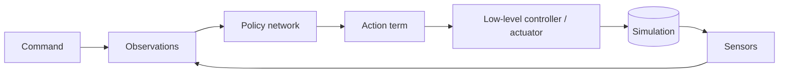

# <Task name>

**Gym IDs:** `IsaacContrib-<Domain>-<Task>-<Variant>`
**Base:** `<parent env cfg, or "from scratch">` · **Copied from:** `<task whose mdp terms were copied>` · **Sources:** <paper, year>

## 1. Summary

One to three sentences: what the task studies and how it differs from its base.

## 2. Architecture

The whole control pipeline, from command to joint torque. Update it whenever a module is added, removed or
rewired, including changes to the network's shape.

| Module | Rate [Hz] | Input → output | Notes |
|---|---|---|---|
| Policy | $1/(\Delta t_{sim} \cdot \text{decimation})$ | $o_t \to a_t$ | |
| Actuator | $1/\Delta t_{sim}$ | $q^{\ast}, q, \dot q \to \tau$ | |

**Networks.** Shape of every network (actor, critic, encoders, estimators):

| Network | Input (dim) | Layers | Output (dim) | Trained by |
|---|---|---|---|---|
| Actor | `policy` (n) | MLP [512, 256, 128], ELU | $\mu, \sigma$ (m) | PPO |
| Critic | `critic` (n) | MLP [512, 256, 128], ELU | $V$ (1) | PPO |

## 3. Method

List only what differs from the base. Weights are per second (Isaac Lab multiplies them by the step $\Delta t$).

### 3.1 Observations

| Group | Term | Definition | Dim |
|---|---|---|---|

### 3.2 Actions

$q^{\ast}_t = q_0 + \sigma\, a_t$

### 3.3 Rewards

$r_t = \Delta t \sum_i w_i\, r_i(s_t, a_t)$

| Term | $r_i$ | $w_i$ |
|---|---|---|

### 3.4 Events and randomization

| Term | Mode | Distribution / trigger |
|---|---|---|

### 3.5 Terminations and curriculum

### 3.6 Algorithm

Loss, hyperparameters and training stages (e.g. teacher → student distillation).

## 4. Deviations

Values the sources do not fix, and why they were chosen.

## 5. Changelog

- YYYY-MM-DD: change. Reason.
