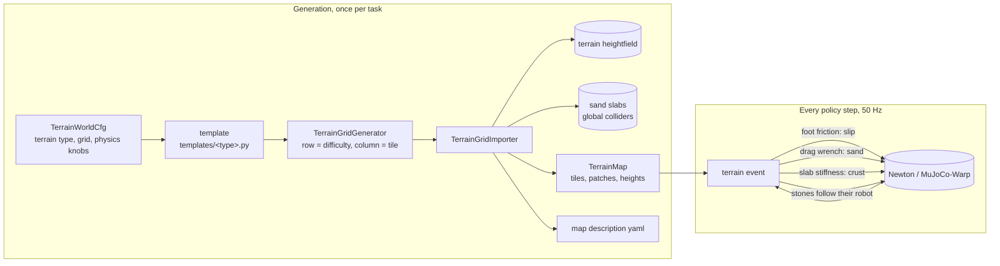
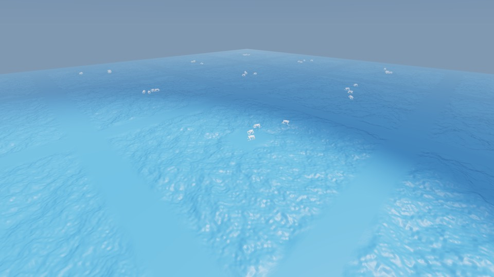
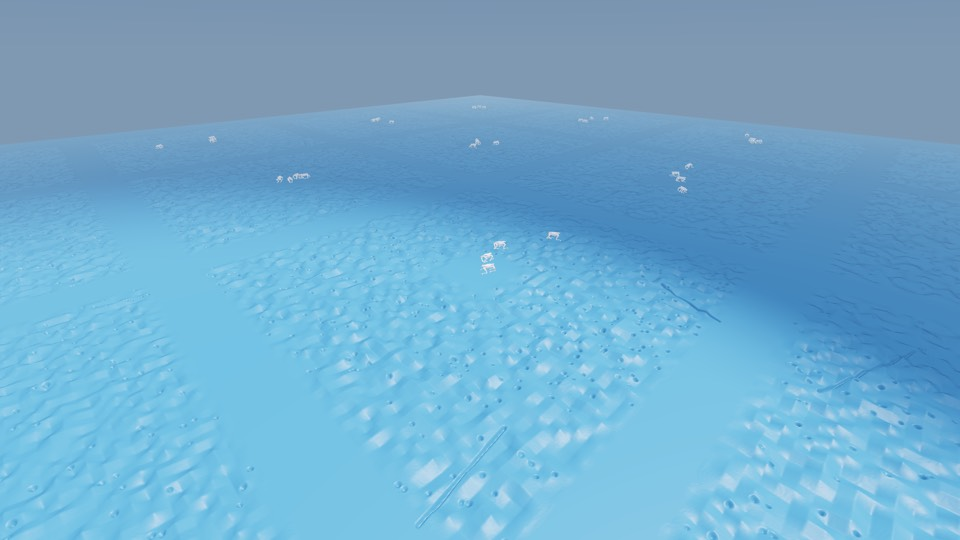
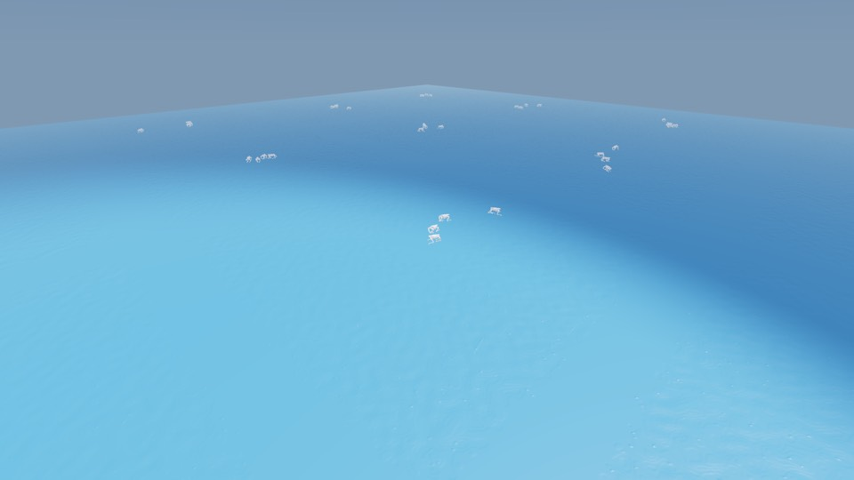
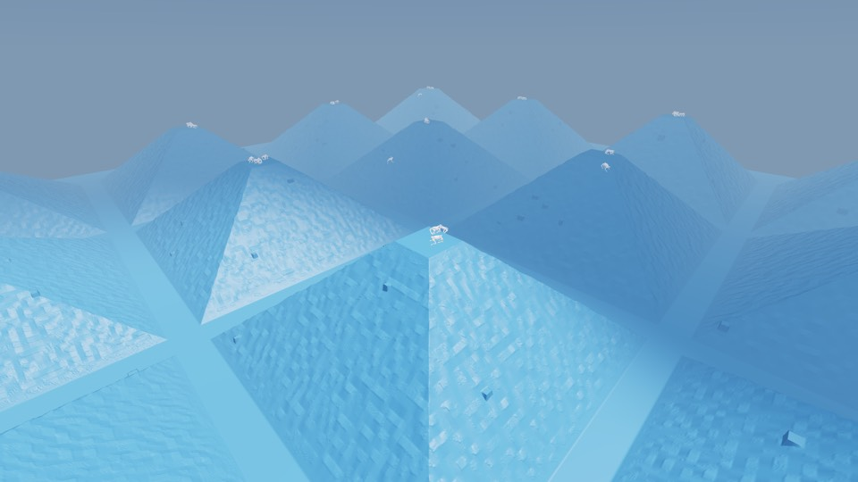
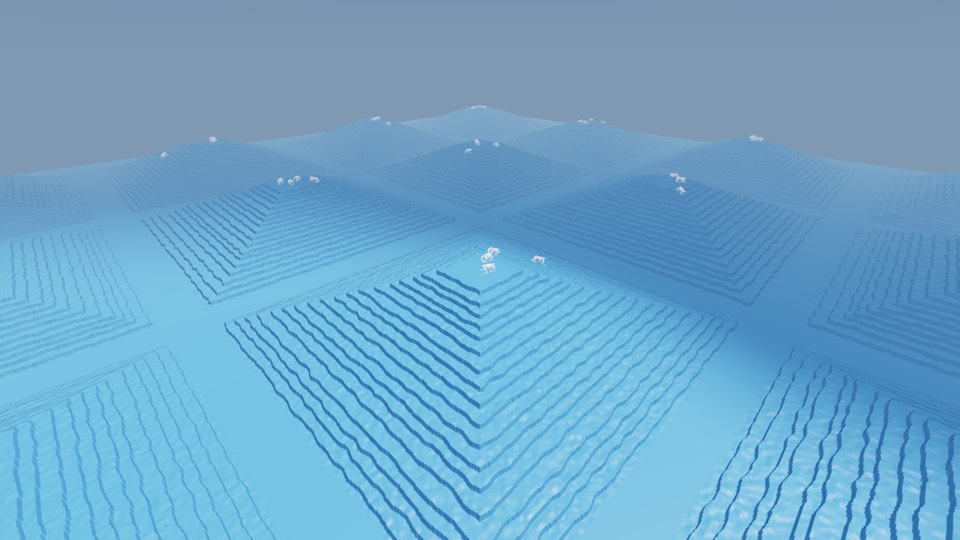
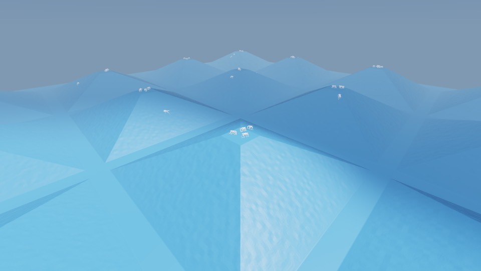
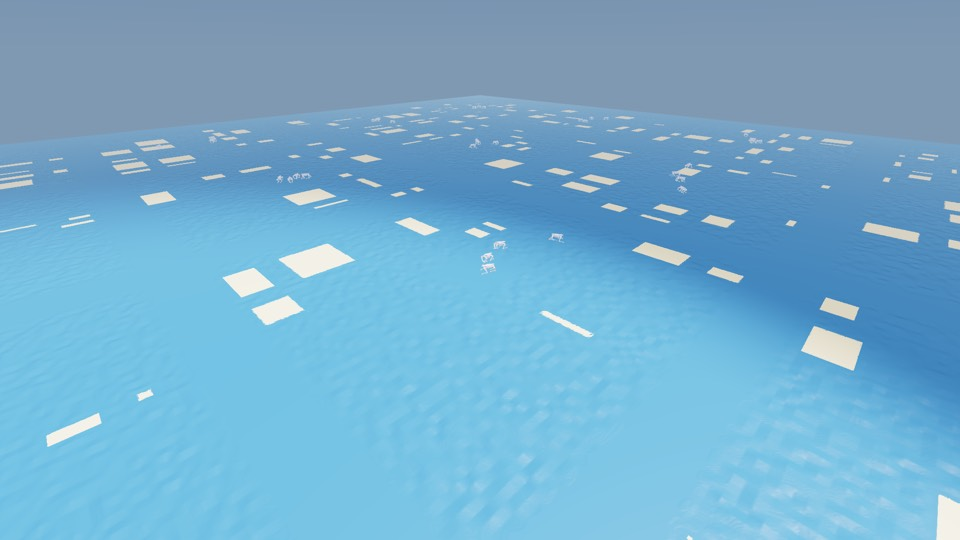
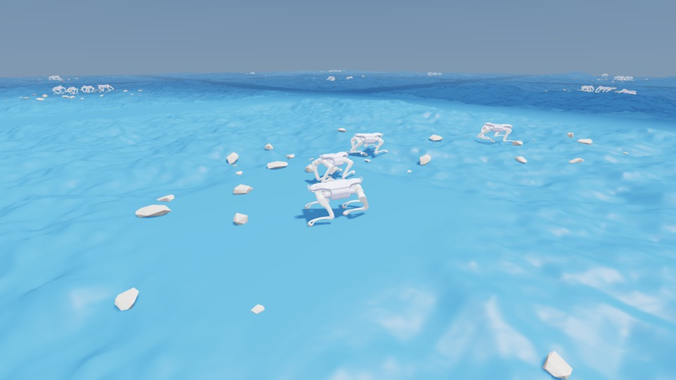
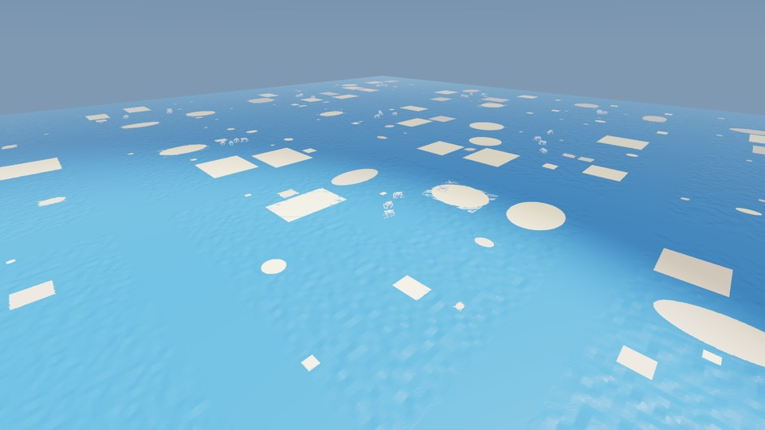

# Terrain templates

**Gym IDs:** `IsaacContrib-Terrain-<Type>-A2{Robust,Energy}`, `<Type>` ∈ `RoughField`, `PitField`, `StubField`,
`RoughSlope`, `RoughStairs`, `SlipSlope`, `SandField`, `GravelField`, `CrustCollapse` (18 tasks)
**Base:** `A2RobustTeacherEnvCfg`, `A2EnergyTeacherRoughEnvCfg` (`velocity/a2_velocity`), with their runner cfgs ·
**Copied from:** `a2_velocity/mdp/events.py:randomize_foot_friction` (the Newton friction binding) ·
**Sources:** "Harsh World 구현 명세서 — fault 관측용 지형" (2026-10-24)

## 1. Summary

Terrain-generation algorithms ("templates") for observing failures of trained policies. A task's map holds one
terrain type: 5 difficulty rows x 5 tiles, each tile with its own random layout. A trained A2 policy
walks it under random commands; its observations and actions are untouched, so its checkpoint loads as it is.
Failure analysis is left to `scripts/forge/fault_analysis` (`collect.py`, `analyze.py`,
`render.py`), which takes these tasks like any other task with a generated terrain.

Until 2026-10-24 this was the "Harsh World" (`velocity/a2_harsh_world`): all ten types side by side on one map, with
zone labels per step. §6 lists what changed.

## 2. Architecture

| Module | Rate | What it does |
| --- | --- | --- |
| Policy, actuators | unchanged | the trained task's (CPG teacher or energy policy) |
| `terrain` event (`mdp/events.py:terrain_step`, interval 0 s) | 50 Hz | only what the type needs: slip friction, sand drag, crust collapse, stone recycling (1 Hz) |

Networks: the trained tasks' (unchanged).

**Code layout.**

| Path | Content |
| --- | --- |
| `templates/common.py` | `TerrainTemplateCfg` (shared knobs), `height_field_template` (decorator), `Grid` (tile pixels, masks, seeded RNG), `finish`, shared feature generators (noise, fractal `rough`, pits, trenches, stubs) |
| `templates/<type>.py` | one terrain-generation algorithm and its cfg (`rough_field`, `pit_field`, `stub_field`, `slope`, `stairs`, `sand`, `gravel_field`) |
| `world_cfg.py` | `default_terrains()` (the catalog: name → template cfg), `TerrainWorldCfg` (grid, spawn, commands) and the physics cfgs (slip, sand, collapse, rocks) |
| `mdp/generator.py` | grid generator, importer (slabs, robot spread), `TerrainMap`, map description |
| `mdp/events.py` | the runtime physics event |
| `env_cfg.py` | `apply_terrain`: a trained task's env cfg → a terrain map; one env cfg per policy |
| `__init__.py` | `TERRAINS` and the gym registration of every (type, policy) |
| `images/` | one render per type (§3.3) |

## 3. Method

### 3.1 Template contract

A template is `f(d, cfg) → (h, origin)`, decorated with `height_field_template` (Isaac Lab's
`height_field_to_mesh` with a linearly extrapolated instead of a zero one-pixel border): `h` is an `int16` height
field in units of `vertical_scale` on the tile's pixel grid, `origin` the spawn point. Every template

* starts with `Grid(cfg, d)` and ends with `finish(grid, h, cfg, base)`, which resets the outer `edge_width` = 1 m
  band to `base` (tiles meet without a step), levels the central `platform_width` = 3 m square to its median
  (spawn), quantizes, and keeps the heights for the terrain map. `base` is 0, except for the inclines (`slope.py`,
  `stairs.py`), whose base profile `b(x)` is the same on every tile of a row; the generator lifts each row so that
  its `-x` edge meets the previous row's `+x` edge;
* fades features in over `blend_width` = 1 m from both (`grid.fade`);
* reads a knob `(lo, hi)` as `lerp = lo + d (hi - lo)` for densities, counts and amplitudes, and draws per-instance
  sizes from `U(lo, lerp)` (`upto`);
* draws randomness only from `grid.rng`, seeded by `(seed, crc32(name), round(10⁶ d), tile)`: a tile does not depend
  on the generation order, the tiles of a row differ, and a seed reproduces the map exactly;
* writes what the importer or the tests need to `cfg.features` (sand `patches`, `pits`, ...), in meters
  relative to the tile center.

Adding a type: a module in `templates/`, an entry in `default_terrains()`, its name in `TERRAINS`
(`templates/__init__.py` lists the steps). The zone (`rigid`, `slip`, `sand`) selects the runtime physics.

### 3.2 Map

Tiles are `tile_size` = 24 m squares on a 5 x 5 grid (120 x 120 m): row `i` has difficulty
`d_i = 0.4 + 0.6 i / (num_levels - 1)` (0.4, 0.55, 0.7, 0.85, 1.0), and each row holds `tiles_per_level` = 5 tiles.
A template may set its own `difficulty_range`: the inclines use (0, 1), so their rows are 0, 11.25, 22.5, 33.75 and
45 deg. Rows run along x, so an incline map is one hillside rising along x (55 m in total for `rough_slope`). The
outer border (5 m) continues the height of each edge pixel outward instead of sitting at z = 0.
`num_envs = 5 x 5 x 4 = 100`; the robots of a column cycle through the rows, so each tile gets 4. Resets return a robot to its own tile's platform (offset `U(±0.57 m)²`, yaw
`U(±π)`, at rest, base 0.45 m above it). Episode 60 s.

### 3.3 Terrain types

| Type | Template | Zone | Geometry |
| --- | --- | --- | --- |
| `rough_field` | `rough_field.py` | rigid | fractal value noise: `octaves` = 4 layers from rolling folds (`fold_size` 8→4 m, ±0.1–0.4 m) down to fine bumps (`unit_size` 0.1–0.2 m, ±2–5 cm, facets), sizes and amplitudes in geometric progression; each layer fades in over half its wavelength from the edge band and platform |
| `pit_field` | `pit_field.py` | rigid | uniform heights on a grid of `unit_size`, linearly interpolated (facets), conical pits (`h -= depth (1 - ρ/r)`, raised rim), V-trenches |
| `stub_field` | `stub_field.py` | rigid | ±1 cm ground, spherical domes `h += H sqrt(1 - (ρ/r)²)` (r ≤ 5 cm), half-cylinder roots |
| `rough_slope` | `slope.py` | rigid | one-direction incline `b(x)` of `slope_deg` 0–45 deg along x through a 3 m flat landing (spawn), blended over 1 m; columns in `smooth_tiles` (0, 1) plain, the others with the fractal roughness (folds ±5–25 cm) |
| `rough_stairs` | `stairs.py` | rigid | one-direction stairs at `slope_deg` 0–45 deg: tread `step_width` 0.35→0.25 m, riser `tread x tan θ` (0.25 m at 45 deg), up along +x and down along -x from the landing; rough columns: treads `U(0.8, 1.2)` (rescaled to the clean flight's length), step edges eroded (`edge_jitter` ≤ 8 cm), ≤ 3 cm noise |
| `slip_slope` | `slope.py` | slip | incline of 18–30 deg (d 0.4–1.0), fine noise ≤ 3 cm on the rough columns, no folds |
| `sand_field` | `sand.py` | sand | rough hardpan; patchwork of patches: the tile is cut into an irregular grid (cells 1.2–4.5 m per column and row), 25–45 % of the cells hold a rectangle inset by 0.4 + U(0, 0.6) m per side; each patch flattened to its mean level `s` around the slab footprint, interior lowered by `sand_depth` keeping half the roughness, 0.1 m ramp |
| `gravel_field` | `gravel_field.py` | rigid | `rough_field` ground with loose stones only (no static ones): 8 per robot, 10–45 cm, 80 % flat (all above 20 cm) (height 15–40 % of the length, flat top and bottom faces), width 50–90 % of the length, random hulls; resting on the bumps, they tilt when stepped on near an edge |
| `crust_collapse` | `sand.py` | sand | `sand_field` with 40 % crust patches |

**Renders.** One middle-difficulty tile (row 2 of 5: d = 0.7, for the inclines d = 0.5 = 22.5 deg) of each type,
column 2 (a rough column for the inclines), seed 42, with the robust policy walking for 5 s, seen from the -x
(downhill) side (Newton GL viewer, which draws the terrain blue and the sand slabs and rocks white; neighboring tiles
of the same type show at the edges); for `gravel_field` a robot close-up instead (the stones stay within 3 m of
their robot; the viewer draws every robot's stones). Regenerate with `probe.py view`
(`scripts/reinforcement_learning/terrain/README.md`).

| `rough_field` (rigid) | `pit_field` (rigid) |
| --- | --- |
|  |  |
| **`stub_field` (rigid)** | **`rough_slope` (rigid)** |
|  |  |
| **`rough_stairs` (rigid)** | **`slip_slope` (slip)** |
|  |  |
| **`sand_field` (sand)** | **`gravel_field` (rigid)** |
|  |  |
| **`crust_collapse` (sand)** | |
|  | |

### 3.4 Runtime physics (`mdp/events.py`)

**Contact model.** MuJoCo-Warp resolves friction as `max(μ_a, μ_b)` and contact softness by `solref`/`solimp`.
The terrain gets `ground_mu` = 0.02, so the foot's own μ decides the contact friction everywhere. Sand slabs and
feet use Newton's force-space contact (`mujoco.solref_mode = FORCE_SPACE`), so a slab's `ke` [N/m] and
`kd = 0.1 ke` act as a linear spring-damper; slabs carry `mjc:priority = 1`, so a foot-slab contact takes the slab's
stiffness and friction (0.6). A slab is a static box from the sand surface 0.6 m down (through the hardpan), so a
sinking foot meets the hardpan before it could be pushed out of the box.

**Slip** (zone `slip`). Per foot, on entering the tile grid (in practice at spawn): with probability `slip_prob` =
0.75, `μ ~ U(lo(d), hi(d))` with `[lo, hi]` interpolated from (0.05, 0.35) at d = 0 to (0.03, 0.25) at d = 1, else
`μ_nominal` = 0.8; kept while on the grid (`resample_on_touchdown` redraws at every touchdown), `μ_nominal` again on
leaving it or on reset. Only the changed environments' foot shapes are written.

**Sand** (sand patches). A foot is in the sand if it is over a soft patch footprint and `z_foot < s + r_foot`. Then
`F_xy = -c_drag(d) v_xy`, `F_z = -c_suction(d) max(v_z, 0)` (c_drag 20–80, c_suction 30–150 N s/m), capped at 60 N,
applied in the world frame through the robot's permanent wrench composer; all other feet get exactly 0.

**Crust collapse** (crust patches). Per robot, the summed vertical contact force of its feet on a crust patch;
above `collapse_force(d)` = (1.5–3) x 98 N the patch collapses: its `ke` drops from 3e4 N/m to `ke/10` (`soften`)
or `1e-4 ke` (`disable`, the foot drops to the hardpan) for `recover_time` = 30 s.

**Stones** (`gravel_field`). Every stone is a dynamic convex body (density 2000–3000 kg/m³, μ 0.8–1.0, `condim` 6
with torsional 0.02 / rolling 0.005 friction): high friction, so a stone stepped on near its edge tilts and rocks
on its support instead of sliding off. MuJoCo-Warp keeps each robot in its own world, so each robot has its own
`dynamic_rocks` = 8 stones (log-uniform 10–45 cm, stratified, so every robot has kickable stones and slabs to stand
on), and the cost grows with the stones per robot, not with the field. The stones follow their robot: placed around
it at the first reset, then every `recycle_interval` = 1 s, the stones more than 3 m from it (horizontally) move to
the free spot with the most clearance among 8 random spots 1.2–3 m ahead (within ±1 rad of its walking direction,
clamped to the tile grid), dropped 1 cm above the highest ground under them. The robust policy's foot scanners see only the global terrain
(`global_world_only`), so the stones are invisible to it and a moved stone never pops into its view.

The event's per-foot state (`foot_mu`, `low_mu`, `in_sand`, `collapse_event`) is public, for analyses that want it.

## 4. Deviations

### 4.1 Forced by the installed stack

Installed: Isaac Lab 3.0.0 (`isaaclab` 41.0.1, kit-less), Newton 1.8.0.dev0 with the MuJoCo-Warp solver
(mujoco_warp 3.15.0), Warp 1.17.0, rsl-rl 5.5.1. The trained A2 policies run on Newton, so the maps do too
(PhysX would add a simulator gap to every failure).

| Spec item | Here | Why |
| --- | --- | --- |
| `PhysxRigidBodyMaterialCfg(compliant_contact_*)` slabs | Newton shape `ke`/`kd` in force-space mode + `mjc:priority` | PhysX compliant contact does not exist under Newton |
| `friction_combine_mode="min"` | terrain μ 0.02 | MuJoCo-Warp combines friction by `max`; a low ground value lets the foot decide (as the trained tasks do) |
| `root_physx_view.set_material_properties` | Newton `shape_material_mu` binding + `add_model_change` | Newton API |
| `set_external_force_and_torque` | `permanent_wrench_composer.set_forces_and_torques_index(is_global=True)` | Isaac Lab 3 API |
| `RayCasterCfg.mesh_prim_paths` with slab meshes | nothing to do | Newton's ray caster hits every collision shape of the global world, slabs and rocks included |
| one shared `RigidObjectCollection` of 1500 rocks | `dynamic_rocks` stones per robot that follow it (8 by default) | MuJoCo-Warp simulates each robot in its own world; a body cannot be shared, so a tile-wide field would cost its full stone count per robot |
| kinematic buried rocks | none: every stone is dynamic (the user's request of 2026-10-25) | a stone should tilt when stepped on near its edge |
| `MeshCuboidCfg` slab, bottom at the lowest hardpan − 2 cm | box primitive (`CuboidCfg`) from the sand surface down 0.6 m | against a triangle-mesh slab, a foot sphere that sinks deeper than its radius (3.2 cm) passes the top face and is pushed through (800 and 3000 N/m both fell to the hardpan). A box pushes back along its nearest face |
| PhysX sleeping | none; rocks get MuJoCo `condim` 6 (torsional 0.02, rolling 0.005 friction) | MuJoCo-Warp has no sleeping and ignores rigid-body damping; small resting rocks kept rocking at 1–2 cm/s |
| slab collision toggle (`disable`) | `ke x 1e-4` | the per-contact force-space path reads `ke` every step (a change during contact takes effect in the next step); no prim or collision change at runtime |
| `convert_to_heightfield=True` | as specified | measured against the triangle mesh: 2 s of a 16-robot world took 2.6 s (heightfield) vs. 35 s (mesh), a 30-tile world ran out of memory (32 GB) with the mesh, and convex rocks found no contacts with it |

### 4.2 Choices the spec leaves open

* **One terrain type per map** (2026-10-24, the user's request): a map shows one failure source at a time, and
  `fault_analysis` attributes events by task and difficulty row (`terrain_levels`) without zone labels.
* **Difficulty without Isaac Lab's random row offset**, so a tile's difficulty is exactly its row's.
* **Flat 1 m edge band** in every template but the inclines, so tiles of different difficulty meet at z = 0 (the
  spec's continuity test asks for `|z| < 2 cm` in the outer 1 m). The inclines (one-direction slopes and stairs,
  the user's request of 2026-10-24) cannot return to z = 0 at both ends; instead every tile of a row shares the base
  profile, the rows are chained along x, and the border continues the edge heights (tested: the largest pixel step
  across any tile seam is one pixel of the 45 deg incline).
* **No vertical-surface correction** (`slope_threshold=None`): Isaac Lab's correction moves mesh vertices off the
  grid wherever a pixel rises more than 0.75 pixel widths, which turned the 45 deg incline into one-pixel steps; the
  collider is a heightfield of the same grid anyway, so it now equals the template exactly.
* **Fractal roughness** (`rough`): the user asked for small plus large noise as in Minecraft-style generators;
  value noise per octave (the reference gravel's interpolated uniform grid) is cheap (one spline per layer) and
  keeps the fine layer's facets.
* **Sand patchwork**: patches are axis-aligned rectangles from an irregular grid rather than freely placed
  ellipses and squares, so they match the box slabs that fill them, and they never get closer than two flattened
  rims (0.7 m), so no patch's rim disturbs another's surface level.
* **Per-tile random generator** seeded by (seed, type, difficulty, tile) instead of the global NumPy state; the
  map description is byte-identical for a seed (tested).
* **Sand patch surface** = the mean hardpan level inside the patch, with the hardpan flattened to it around the
  slab (the spec's "maximum height" would leave a step of up to 2 x amplitude at the patch border).
* **Slip unobserved by default** (`observe_slip=False`): the policies' privileged friction input keeps reporting
  the nominal μ, as a deployed robot would not know it.
* **No disturbances, no curriculum**: pushes and the external wrench are removed (failures should come from the
  terrain; the sand drag also owns the feet's wrench).
* **Commands**: the robust policy gets the spec's ranges (`v_x` −0.5–1.5, `v_y` ±0.5, `ω_z` ±1, resampled every
  5–10 s, no heading control); the energy policy has no command input (fixed 0.9 m/s forward) and keeps it.
* **Crust load** is summed per robot (each robot lives in its own physics world) while the collapse state is shared
  by all robots (one map); one robot's step can collapse a patch for everyone.
* **Slip twin** (T3 probe): every second robot on the same `slip_slope` map with slip switched off, instead of a
  separate rigid twin column.
* **A2 foot** (open question 1): sphere, r = 0.032 m, 0.046 kg; nominal μ 0.8.

## 5. Results

Euler, one RTX 4090, Newton/MJWarp, robust teacher `a2_robust_teacher_s0/model_2999.pt`, seed 42.

### 5.1 Revised terrain types (2026-10-24, 9 types)

Raw logs: `tr9b_test`, `tr9_view_all`, `tr9_smoke_all` on Euler. Smoke runs: 120 s per type, 5 x 5 map, 100
robots. The physics probes (T0, T2 sinkage and drag, T3, T6 rocks at rest and collapse) were not rerun: the slip,
sand, collapse and rock code is unchanged (§5.2).

| Test | Item | Measured | |
| --- | --- | --- | --- |
| T1 | `test_terrain.py` (23 tests) | 23 passed | pass |
| T1 | edge band = base profile, flat platform, tile seams (all 9 types, 5 x 2 tiles) | 0.00 cm off the base profile, platform range 0; largest seam step 0.00 cm (zero-edge types), 3.00 cm (`rough_slope`: one pixel of 45 deg) | pass |
| T1 | incline rows (`rough_slope`, smooth column) | 0.0, 11.2, 22.5, 33.8, 45.0 deg measured = set; row lifts 0, 2.0, 8.1, 19.0, 35.6 m | pass |
| T1 | `rough_stairs` at 45 deg | riser 0.25 m, 37 steps per side; a rough tile's edge levels equal the clean tile's (≤ 0.5 cm) | pass |
| T1 | `rough_field` at d = 1 | relief smoothed over 1 m spans 1.19 m; mean pixel step 0.48 cm | pass |
| T2 | slab top vs hardpan ≤ 1 cm; patches ≥ 0.7 m apart | 0.63 cm (`sand_field`, 232 patches on 5 x 3 tiles), 0.63 cm (`crust_collapse`, 258 patches, 96 crusts) | pass |
| T1 | generation of one 5 x 5 map | 14–16 s per type (Euler CPU) | pass |
| T4 | spawn on the platform; no fall within 1 s (all 9 types) | 0 falls | pass |
| T4 | real-time factor at 100 robots | rough_field 3.44, pit_field 3.54, stub_field 3.62, rough_slope 3.43, rough_stairs 3.39, slip_slope 2.66, sand_field 2.85, gravel_field 0.94 (8 stones per robot; 12: 0.76, 16: 0.57), crust_collapse 2.70 | **fail** vs 5 x |
| T6 | `gravel_field` (all-dynamic stones, 2026-10-25) moving-stone foot contacts ≥ 1 per minute | 5961 per minute (100 robots); a stone moves with no foot near it 2.3 % of the time (mostly the 1 cm drop after a recycle) | pass |
| T6 | `gravel_field` stones at rest (8 robots x 8 stones, 10 s) | net speed ≤ 0.004 m/s, 0 below the terrain, 98.2 % of stone-steps at rest after 5 s | pass |
| T6 | `gravel_field` recycle | robot 0 moved 8 m: its 8 stones land 1.45–2.95 m from it, ≥ 0.48 m apart; the other robots' nearby stones move 0.0 mm | pass |
| T6 | stability: NaN, bodies > 20 m/s on `crust_collapse` (all types) | all smoke checks pass | pass |

Terminations per minute: slip_slope 109, rough_stairs 47.5, rough_slope 31.5, gravel_field 3.0, rough_field 2.5,
stub_field 2.0, sand_field 2.0, crust_collapse 2.0, pit_field 0. The one-direction slope ends fewer episodes than
the old pyramid (119.5 at d 0.4–1.0) although its rows reach 45 deg: its first rows are gentle (0–22.5 deg), and
two of five columns are plain. The patchwork sand (about 15 patches per tile instead of 7) costs no speed.

### 5.2 Terrain-map layout (2026-10-24, after the move to `forge/terrain`, before the type revision)

Raw logs: the `tr_*` and `tr55_*` run logs on Euler. Smoke runs (`tr55_smoke_all`): 120 s per terrain type on the
default 5 x 5 map, 100 robots (5 rows x 5 tiles x 4). The probe rows (T0, T2, T3, T6 rocks / collapse) and the
generation time were measured on the earlier 3 x 10 default (120 robots); the probes do not depend on the grid shape.

| Test | Item | Measured | |
| --- | --- | --- | --- |
| T1 | `test_terrain.py` (23 tests): every template has a zero edge band and a flat platform; the tiles of a row differ; same seed → byte-identical yaml; catalog = registered names | edge \|z\| 0.00 cm, platform range 0 for all 10 types | pass |
| T1 | `test_terrain.py` rerun on the 5 x 5 default (`tr55_test`) | 23 passed | pass |
| T1 | generation of one map (3 x 10 tiles) | 21–25 s per type (Euler CPU) | pass |
| T0 | spheres dropped on `rough_slope`, robots standing | max depth 0.1 cm, min base 0.30 m | pass |
| T2 | `sand_field` sinkage 800 / 3000 N/m, rigid; scanner; drag | 8.15 / 2.25 cm, 0.06 mm; 0.00 cm; 22.00 N for 22.00 N | pass |
| T2 | slab top vs hardpan ≤ 1 cm | 0.76 cm (`sand_field`, 105 patches), 0.66 cm (`crust_collapse`, 44 crusts) | pass |
| T3 | `slip_slope`: applied μ = sampled μ; KS; slide vs. the rigid twin (16 + 16 robots, 60 s) | exact after 92 changes; KS p 0.72, low share 0.724; 32.2 vs 8.3 m (x3.9) | pass |
| T4 | spawn on the platform; no fall within 1 s (all 10 types) | max offset 0.57 m; 0 falls | pass |
| T4 | real-time factor at 100 robots | gravel 3.50, stub_field 3.58, rough_slope 3.10, rough_stairs 3.26, slip_slope 2.63, sand_field 2.87, mixed 3.47, mesa_drop 3.15, loose_rocks 1.71, crust_collapse 2.76 | **fail** vs 5 x (the mixed 120-robot map: 1.5–1.6) |
| T6 | `mesa_drop` flights ≥ 1 per minute | 22.0 per minute | pass |
| T6 | `loose_rocks` moving-rock foot contacts ≥ 1 per minute | 108.5 per minute | pass |
| T6 | rocks at rest after 10 s: 32 rocks; 1504 rocks (94 robots x 16) | net ≤ 0.0001 m/s, 100 %; net ≤ 0.0006 m/s, 0 sunk, 99.5 %; rock return moves only the drifted ones | pass |
| T6 | collapse `soften` / `disable` | ke 3e4 → 3e3 / 3 N/m; sinkage 4.6 → 36.2 mm (x7.9) / to the hardpan (85 mm, hardpan 84 mm); holds 98 N, collapses in the step above 206 N, restored | pass |
| T6 | stability: NaN, bodies > 20 m/s (all types) | 0 NaN; 0 fast robot-steps (all smoke checks pass on 5 x 5); 84 collapses in 120 s on `crust_collapse` (3 x 10) | pass |
| – | `fault_analysis/collect.py` and `render.py` on `IsaacContrib-Terrain-SandField-A2Robust` (unchanged scripts) | 155 events in 1500 steps; event 16 re-rendered on the regenerated terrain | pass |

Terminations per minute (100 robots, 5 x 5), as a first look at where failures come from: slip_slope 214.5,
mesa_drop 147.5, rough_slope 119.5, rough_stairs 32.5, mixed 6.5, sand_field 3.5, loose_rocks 3.0, gravel 2.5,
stub_field 1.0, crust_collapse 1.0 (on 3 x 10 with 120 robots and difficulty 0.4–1.0 in 3 rows: 243, 190, 183, 34,
4, 1, 5, 3.5, 2.5, 2.5). The real-time factor rose from 1.5–1.6 (mixed map, labels) to 2.6–3.6 on all types but
`loose_rocks` (4 dynamic rocks per robot: 1.71); 100 instead of 120 robots barely changes it.

### 5.3 Measured on the Harsh World layout (2026-10-24, before the move)

The templates and the runtime physics are unchanged by the move (only the tile RNG gained the tile index), so these
results carry over. Smoke runs: 5 min, seeds 42 / 7 / 3, 84 and 120 robots on the mixed map.

| Test | Item | Measured | |
| --- | --- | --- | --- |
| T1 | gravel correlation length = unit ± 30 %, range = amplitude ± 20 %, facets | 0.150 / 0.270 / 0.450 m for units 0.15 / 0.3 / 0.5 (e-folding at 0.86 unit); max \|h\| 0.049 / 0.099 / 0.179 for 0.05 / 0.1 / 0.18; 100 % of \|∂²h\| on the facet edges | pass |
| T1 | stubs seen by a 0.1 m scanner grid < 35 % | 30.1 % of 1432 | pass |
| T1 | pit radius and depth in range | measured / set depth median 0.88 (gravel), 0.87 (mixed) | pass |
| T2 | 10 kg foot sphere dropped from 10 cm: sinkage 1 cm – `sand_depth`; rigid < 2 mm | 800 N/m: 8.1 cm (down to the hardpan), 3000 N/m: 2.3 cm; rigid 0.06 mm | pass |
| T2 | scanner over a patch within ±1 cm of its surface; slab top vs hardpan ≤ 1 cm | 0.00 cm; 0.60 cm | pass |
| T2 | drag = `c_drag` 0.5 m/s ± 5 %, exactly 0 outside the sand | 22.00 N for 22.00 N; 0 N | pass |
| T3 | applied μ = sampled μ; 1000 entry samples KS p > 0.05, low share ± 5 % | exact; KS p 0.19, low share 0.746 | pass |
| T3 | foot slide on `slip_slope` ≥ 3 x the rigid twin's | x4.1 with `slip_prob` 0.75 (x2.6 with the spec's 0.5) | pass (tuned) |
| T4 | robots spawn on their platform; none falls within 1 s | max offset 0.57 m; 0 falls | pass |
| T4 | ≥ 5 x real time at 84 robots | 2.28–2.39 (the unmodified trained task: 3.08) | **fail** |
| T6 | `mesa_drop` flights ≥ 1 per minute | 2.2–3.4 per minute (0 with the spec's geometry) | pass (tuned) |
| T6 | 1500 rocks, 10 s: at rest, none in the terrain, ≥ 95 % at rest after 5 s | 1504 rocks: net speed ≤ 0.0005 m/s, 0 sunk, 99.2 % | pass |
| T6 | rocks cost ≤ 30 % of the real-time factor | 4 rocks per robot: 73–79 % | pass (tuned) |
| T6 | collapse: holds, collapses within a step, sinkage ≥ 3x, recovers; stable | soften 4.6 → 36.2 mm (x7.9); disable to the hardpan; 0 NaN, 0 fast bodies | pass |

**Real-time factor.** The 5 x target of the spec was out of reach: the unmodified trained task runs at 3.1 x real
time at 84 robots, bound by the per-step cost of the manager-based env (MJWarp worlds are small; resolution and
tile size changed nothing). The zone labels of the Harsh World cost about 1 ms per step; the terrain maps have no
labels, and the event skips the physics a type does not need.

**Tuned defaults** (spec → now): `slip_prob` 0.5 → 0.75 (slide ratio x2.6 < 3); `mesa_height` / `drop_height` /
`tread_width` (0.6, 2) / (0.3, 1) / (1, 2.5) → (3, 4) / (1.5, 2) / (4, 4) and `scree_prob` / `rubble_prob` 0.4 /
0.2 → 0.2 / 0.1 (no flight in 60 s: the policy steps down drops of up to 1 m); `platform_width` 2 → 3 m (robots
touched the stairs and slopes at the platform edge within 1 s); dynamic rocks 1500 in total → 4 per robot (16 cost
58 % of the real-time factor); rock torsional / rolling friction 0.02 / 0.005 (new; resting rocks rocked at 1–2 cm/s).

## 6. Changelog

- 2026-10-24: First version as the Harsh World (`velocity/a2_harsh_world`): 10 properties on one mixed map, zone
  map and labels, slip/sand/collapse/rock interactions, build and probe scripts. Reason: the Harsh World spec.
- 2026-10-24: After the first GPU runs. Heightfield collision, box sand slabs, one static convex collider per rock,
  `condim` 6 rock friction, labels computed once per step; probes measure penetration, known loads, and
  window-averaged sinkage. Reason: convex rocks and deep-sinking feet passed through triangle meshes, the mesh world
  ran out of memory, and the probes measured their own artifacts.
- 2026-10-24: Default tuning (§5.3): `slip_prob` 0.75, mesa 3–4 m terraces with 70 % cliffs, 3 m platform, 4
  dynamic rocks per robot. Reason: T3 slide ratio, T6 flights and rock cost, T4 falls.
- 2026-10-24: Moved to `forge/terrain` and reorganized around the templates: one module per template
  (`templates/`), one map per terrain type (3 difficulty rows x 10 tiles, the tile index in the RNG seed), one task
  per (type, policy) `IsaacContrib-Terrain-<Type>-A2{Robust,Energy}` replacing `IsaacContrib-Velocity-A2HarshWorld-*`.
  Removed the zone labels (`zone` observation group), the per-property attribution, and the `faults` probe; the
  event runs only the physics the type needs; `RockCfg.moving_speed` dropped, `rocks_per_cell` → `rocks_per_tile`.
  Scripts moved to `scripts/reinforcement_learning/terrain` (`build.py`, `test_terrain.py`, `probe.py` with `view`).
  Reason: failure analysis belongs to `fault_analysis`; one terrain type per simulation keeps failure sources apart.
  Verified on Euler (§5.2).
- 2026-10-24: Default grid 5 difficulty rows (0.4–1.0) x 5 tiles (was 3 x 10), 100 robots. Reason: the user's
  request, a square 120 x 120 m map with finer difficulty steps.
- 2026-10-24: Terrain types revised (the user's request): `rough_slope` and `rough_stairs` are one-direction
  inclines of 0–45 deg (plain or rough per column, `smooth_tiles`) chained along x instead of pyramids, ledges
  dropped; new `rough_field` (fractal noise: folds plus fine bumps, `fold_size`, `fold_amplitude`, `octaves`, also
  used by the slopes and `gravel_field`); `gravel` renamed `pit_field`; `loose_rocks` renamed `gravel_field`, now on
  the `rough_field` ground with rocks from pebbles to 0.5 m boulders and dynamic rocks partly perched on slopes;
  `mixed` and `mesa_drop` removed; sand patches laid out as a patchwork grid. Supporting changes:
  `height_field_template` (extrapolated tile border), row lift and edge-following border in the generator,
  `slope_threshold=None`, per-template `difficulty_range`. Reason: realistic inclines a robot climbs or descends,
  realistic uneven ground, and sand patches that look natural. Verified on Euler (§5.1).
- 2026-10-25: `gravel_field` stones all dynamic and mostly flat (the user's request): no static rocks, no boulder
  quadrant; 8 stones per robot (10–45 cm, flat top and bottom faces, hulls scaled to their nominal box, stones above
  20 cm always flat) that follow their robot (`recycle_*` in `RockCfg`), μ 0.8–1.0 and rolling / torsional friction
  0.04 / 0.05 so they tilt and rock instead of sliding. Static rock spawning, rock slots and the map's `rocks` list
  removed. Reason: stones to step on that wobble when loaded near an edge; a tile-wide field of dynamic stones would
  cost its full count per robot (MuJoCo-Warp worlds). Verified on Euler (§5.1); the real-time factor drops to 0.94.
