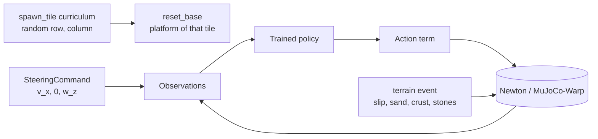

# A2 deployment on terrain maps

**Gym IDs:** `IsaacContrib-Velocity-A2Deploy-<Type>-{Robust,Energy}`, `<Type>` as in `forge/terrain` (18 tasks)
**Base:** `A2RobustTerrainEnvCfg`, `A2EnergyTerrainEnvCfg` (`forge/terrain`), with the trained tasks' runner cfgs ·
**Copied from:** `isaaclab.envs.mdp.reset_root_state_uniform` (`mdp/events.py`) · **Sources:** the user's request of 2026-10-25

## 1. Summary

Play-only deployment of the trained A2 robust teacher and energy (rough) policies on one terrain type, for
collecting falls (`scripts/forge/fault_analysis/campaign.py`). Differences from the terrain-map tasks: only the
map's difficulty rows 1–3, 20 robots that start every episode on a random tile, and forward-only steering commands.
On the inclines (`rough_slope`, `rough_stairs`, `slip_slope`) the robots instead face straight up or down the slope
and get no turn command.

## 2. Architecture

| Module | Rate | What it does |
| --- | --- | --- |
| `spawn_tile` (curriculum) | every reset | draws the episode's tile, before the reset events place the robot |
| `SteeringCommand` | 50 Hz | forward speed and a smoothed yaw rate that turns by a random angle, then stops |
| Policy, actuators, terrain event | unchanged | the terrain-map task's |

Networks: the trained tasks' (unchanged).

## 3. Method

### 3.1 Steering command (robust policy)

Every segment of `U(5, 10)` s draws $v_x \sim U(0.5, 1.0)$ m/s, $v_y = 0$, and a turn
$\Delta\psi \sim U(-\pi/4, \pi/4)$. Each step, with the measured world yaw rate $\omega_z$ and $\Delta t = 0.02$ s:

$$\Delta\psi_{rem} \leftarrow \Delta\psi_{rem} - \omega_z \Delta t, \qquad
\omega^{des} = \begin{cases} \mathrm{clip}(k\,\Delta\psi_{rem}, \pm 0.6) & \text{turning} \\ 0 & \text{else} \end{cases}, \qquad
\omega^{cmd} \leftarrow \omega^{cmd} + \frac{\Delta t}{\tau + \Delta t}(\omega^{des} - \omega^{cmd})$$

with $k = 1$ /s, $\tau = 0.5$ s; turning ends for the segment once $|\Delta\psi_{rem}| < 2°$. The command is zeroed at
an episode reset. On the inclines $\Delta\psi = 0$: $\omega^{cmd} = 0$, the robot walks the way it faces. The
energy policy has no command input (fixed 0.9 m/s forward) and keeps its own command.

### 3.2 Map and spawn

The terrain map keeps the first 3 of its 5 rows at the full map's difficulties: $d = 0.4, 0.55, 0.7$ (inclines
0, 11.25, 22.5°), 5 tiles per row. `spawn_tile` draws row and column uniformly per reset and moves the robot's env
origin there; the robot spawns on that tile's platform (`reset_base`, offset and yaw as in `forge/terrain`). On the
inclines, which rise along $+x$, the yaw is $U(\pm 15°)$ plus $\pi$ for half of the resets
(`reset_root_up_or_down`, copied from Isaac Lab's `reset_root_state_uniform`): the robot faces up or down the slope.

## 4. Deviations

Values the request does not fix:

* $v_x$ range 0.5–1.0 m/s (forward only, inside the trained −0.5–1.5 m/s).
* Yaw-rate limit 0.6 rad/s, $k = 1$ /s, $\tau = 0.5$ s, 2° tolerance: a 45° turn takes about 2 s without a step in
  $\omega^{cmd}$. The turned angle is integrated from the measured yaw rate rather than read from the heading, so it
  needs no heading at the reset step and no angle wrapping.
* The spawn tile is drawn in a curriculum term: Isaac Lab runs the curriculum before the reset events, so the
  robot is placed on the new tile in the same reset.
* Built on `forge/terrain`'s env cfgs and `TERRAINS` (not copied): the terrain maps are shared infrastructure, and a
  copy would drift from the maps the falls are analyzed on.

## 5. Results

Smoke runs on Euler: see `scripts/forge/fault_analysis/README.md`.

## 6. Changelog

- 2026-10-25: Inclines (`rough_slope`, `rough_stairs`, `slip_slope`): spawn facing up or down the slope (±15°), no
  turn command. Reason: the user's request; failures there should come from climbing or descending.
- 2026-10-25: First version. Reason: the user's request (rows 1–3, 20 robots on random tiles, forward steering).
