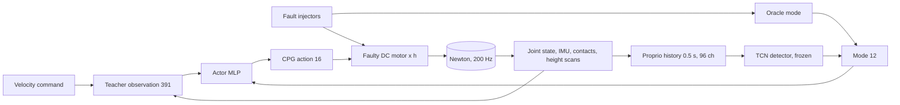

# A2 fault-aware robust policy

**Gym IDs:** `IsaacContrib-Velocity-A2FaultAware-{Blind,Oracle,Detector}`
**Base:** `velocity/a2_velocity` `A2RobustTeacherEnvCfg` (env) and `A2RobustTeacherPPORunnerCfg` (runner) ·
**Copied from:** the TCN of `results/reports/clustering/20261102_mechanism_detection/scripts/detect.py` (network only,
`mdp/fault_mode.py`) · **Sources:** H6 of that study; Miki et al. 2022 for the base.

## 1. Summary

The robust teacher's task with motor faults and stuck feet injected, and a 12-d failure-mode observation appended to
its input: zeros (`-Blind`), the injectors' ground truth (`-Oracle`), or the online output of the mechanism detector
(`-Detector`). Fine-tuned from the teacher's checkpoint to test whether knowing the failure mode helps the policy.

## 2. Architecture

| Module | Rate [Hz] | Input → output | Notes |
|---|---|---|---|
| Policy | 50 | $o_t$ (403) $\to a_t$ (16) | teacher input + mode |
| Detector (`-Detector`) | 50 | 25 × 96 proprio frames → 12 | frozen, from the detection study |
| Actuator | 200 | $q^{\ast}, q, \dot q \to \tau$ | DC motor scaled by health $h$ (`forge/fault_injector`) |

**Networks.**

| Network | Input (dim) | Layers | Output (dim) | Trained by |
|---|---|---|---|---|
| Actor | `policy` (403) | MLP [512, 256, 128], ELU | $\mu, \sigma$ (16) | PPO, from the teacher |
| Critic | `policy` (403) | MLP [512, 256, 128], ELU | $V$ (1) | PPO, from the teacher |
| Detector | 25 × 96 | 4 dilated causal Conv1d (64, k = 3, d = 1, 2, 4, 8), ELU; last + mean → Linear | 12 | offline, frozen |

## 3. Method

Only what differs from the robust teacher.

### 3.1 Observations

| Group | Term | Definition | Dim |
|---|---|---|---|
| `policy` | `fault_mode` | $[p_{any}, p_{fall}, p_{mode}(6), p_{leg}(4)]$; modes slip, support loss, sinkage, obstruction, body contact, actuator; legs FL, FR, RL, RR | 12 |

- `-Blind`: 0.
- `-Oracle`: $p_{any} = [\text{motor fault} \lor \text{stuck foot}]$, $p_{fall} = 0$, actuator = motor fault active,
  obstruction = foot held, the leg of the faulty joint / held foot set to 1.
- `-Detector`: the TCN on $x_{t-24..t}$, $x = \mathrm{clip}((s - \mu)/\sigma, \pm 20)$ with $\mu, \sigma$ of nominal
  walking in the detector's training data; $s$ = joint position, velocity, measured torque, PD torque before the
  fault, joint target (12 each), projected gravity, gyro, IMU specific force $R^T(a - g)$ (3 each), command (3),
  feet in the base frame and their finite difference (12 each). A new episode fills the history with its first
  frame. The command channels are set to their nominal mean (§4).

### 3.2 Events

| Term | Mode | Distribution |
|---|---|---|
| `motor_fault` | interval (each step) | `forge/fault_injector` defaults, $p = 0.4$: one joint, power out or power loss $h \sim U[0.1, 0.6]$, onset $U[2, 8]$ s |
| `foot_stuck` | reset | defaults, $p = 0.4$, own seed 7919: one foot, three modes, onset $U[2, 8]$ s |

Curriculum factor fixed at 1 (the teacher's final reward weights and disturbance ranges).

### 3.3 Training

Fine-tuning: `scripts/forge/fault_aware/pad_checkpoint.py` appends 12 zero columns to the first layer of the
teacher's actor and critic (`model_2999.pt`), so the fine-tune starts from the teacher's exact behavior; the optimizer
starts fresh (`--no-resume_optimizer_state`); 1000 iterations (3000 → 3999).

## 4. Deviations

* The detector was trained on the surveillance maps under the surveillance steering command (forward 0.5–1 m/s, no
  lateral velocity). This task's omnidirectional commands lie ~10 nominal SDs off it (measured, 2026-11-02), which
  biases the detector toward alarms, so its command inputs are held at their nominal mean.
* The detector stays frozen while the policy changes: its input distribution shifts with the fine-tuned gait
  (closed-loop shift, not corrected here).
* Fault probabilities 0.4 / 0.4 as the `-Faults` collection the detector was trained on.

## 5. Results

`results/reports/clustering/20261102_h6_mode_policy/REPORT.md`.

## 6. Changelog

- 2026-11-02: Task created (H6 of the mechanism-detection study). Euler smoke: 2 iterations of `-Detector` and
  `-Oracle` from the padded teacher checkpoint (403-d input, checkpoint loaded). Reason: the user's request.
