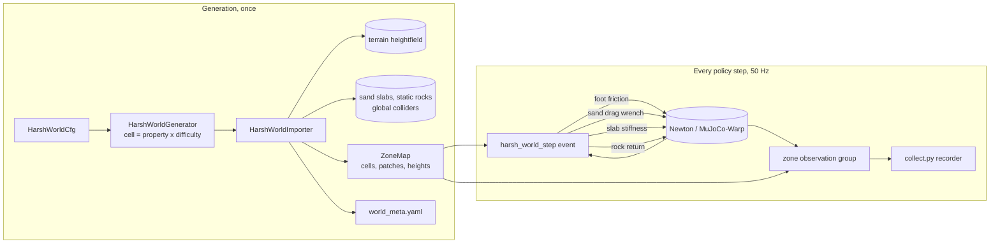

# A2 Harsh World

**Gym IDs:** `IsaacContrib-Velocity-A2HarshWorld-{Robust,Energy}` (7 properties), `…-{Robust,Energy}-Full` (10)
**Base:** `A2RobustTeacherEnvCfg`, `A2EnergyTeacherRoughEnvCfg` (`a2_velocity`), with their runner cfgs ·
**Copied from:** `a2_velocity/mdp/events.py:randomize_foot_friction` (the Newton friction binding) ·
**Sources:** "Harsh World 구현 명세서 — fault 관측용 지형" (2026-10-24)

## 1. Summary

A play-only world for fault analysis: trained A2 policies walk one large grid of hard-terrain cells (column =
terrain property, row = difficulty) under random commands, and every step exposes which cell, property, zone, and
sand patch each foot and the base are on. `fault_analysis/collect.py` (unchanged) records these labels with every
failure because they are an observation group. The policies' observations and actions are untouched, so their
checkpoints load as they are.

## 2. Architecture

| Module | Rate | What it does |
| --- | --- | --- |
| Policy, actuators | unchanged | the trained task's (CPG teacher or energy policy) |
| `harsh_world_step` (event, interval 0 s) | 50 Hz | zone lookup of the feet, slip friction, sand drag, crust collapse, rock return |
| `zone` observation group | 50 Hz | labels from the current state, read by the recorder before the step's events |

Networks: the trained tasks' (unchanged).

## 3. Method

### 3.1 World layout

Cells are `region_size` = 24 m squares; columns are the enabled properties in `HarshWorldCfg.properties` order,
rows the difficulties `d_i = 0.4 + 0.6 i / (num_rows - 1)` (0.4, 0.7, 1.0). Every cell has a flat `edge_width` =
1 m band at its border (z = 0, so cells meet without a step) and a flat 3 m spawn platform; features fade in over
`blend_width` = 1 m from both. A knob `(lo, hi)` takes the value `lo + d (hi - lo)` for densities, counts and
amplitudes; per-instance sizes are drawn from `U(lo, lo + d (hi - lo))`. `num_envs = rows x cols x 4` (84 / 120);
the robots of a column cycle through the rows, so each cell gets 4. Resets return a robot to its own cell's platform
(offset `U(±0.57 m)²`, yaw `U(±π)`, at rest, base 0.45 m above it).

### 3.2 Properties

| # | Name | Zone | Geometry |
| --- | --- | --- | --- |
| 1 | `gravel` | rigid | uniform heights on a grid of `unit_size`, linearly interpolated (facets), plus conical pits (`h -= depth (1 - ρ/r)`, raised rim) and V-trenches |
| 2 | `stub_field` | rigid | ±1 cm ground, spherical domes `h += H sqrt(1 - (ρ/r)²)` (r ≤ 5 cm) and half-cylinder roots |
| 3 | `rough_slope` | rigid | pyramid `h = s min(fx, fy)` to a flat top, gravel noise, flat-topped ledges |
| 4 | `rough_stairs` | rigid | pyramid stairs, step widths `w U(0.7, 1.3)`, step edges eroded by a smooth field of amplitude `edge_jitter`, noise |
| 5 | `slip_slope` | slip | `rough_slope` with `s` 0.25–0.6, noise ≤ 3 cm, no ledges |
| 6 | `sand_field` | sand | gravel hardpan; patches (foot/pair/body, 3:2:2) flattened to their mean level `s` around the slab footprint, interior lowered by `sand_depth` keeping half the roughness, 0.1 m ramp |
| 7 | `mixed` | rigid | gentle pyramid + gravel + stubs + pits + trenches, densities halved |
| 8 | `mesa_drop` | rigid | mesa of `mesa_height` (3–4 m), terraces of `drop = mesa_height / ceil(mesa_height / drop_height)` (1.5–2 m) and `tread_width` (4 m); each side a cliff, a 45° scree ramp (p 0.2) or rubble (p 0.1) |
| 9 | `loose_rocks` | rigid | gentle gravel; static rocks (power-law sizes, 30 % flattened "buried"), a dense quadrant spaced `0.8–1.5 x` body width, dynamic rocks on a ring around the platform |
| 10 | `crust_collapse` | sand | `sand_field` with 40 % crust patches |

### 3.3 Runtime interactions (`mdp/events.py`)

**Contact model.** MuJoCo-Warp resolves friction as `max(μ_a, μ_b)` and contact softness by `solref`/`solimp`.
The terrain gets `ground_mu` = 0.02, so the foot's own μ decides the contact friction everywhere. Sand slabs and
feet use Newton's force-space contact (`mujoco.solref_mode = FORCE_SPACE`), so a slab's `ke` [N/m] and
`kd = 0.1 ke` act as a linear spring-damper; slabs carry `mjc:priority = 1`, so a foot-slab contact takes the slab's
stiffness and friction (0.6). A slab is a static box from the sand surface 0.6 m down (through the hardpan), so a
sinking foot meets the hardpan before it could be pushed out of the box.

**Slip.** Per foot, on entering a slip cell: with probability `slip_prob` = 0.5, `μ ~ U(lo(d), hi(d))` with
`[lo, hi]` interpolated from (0.05, 0.35) at d = 0 to (0.03, 0.25) at d = 1, else `μ_nominal` = 0.8; kept while in
the zone, `μ_nominal` again on leaving or reset. Only the changed environments' foot shapes are written.

**Sand.** A foot is in the sand if it is over a soft patch footprint and `z_foot < s + r_foot`. Then
`F_xy = -c_drag(d) v_xy`, `F_z = -c_suction(d) max(v_z, 0)` (c_drag 20–80, c_suction 30–150 N s/m), capped at 60 N,
applied in the world frame through the robot's permanent wrench composer; all other feet get exactly 0.

**Crust collapse.** Per robot, the summed vertical contact force of its feet on a crust patch; above
`collapse_force(d)` = (1.5–3) x 98 N the patch collapses: its `ke` drops from 3e4 N/m to `ke/10` (`soften`) or
`1e-4 ke` (`disable`, the foot drops to the hardpan) for `recover_time` = 30 s.

**Rocks.** Every robot has its own copy of `dynamic_rocks` = 4 convex rocks (density 2000–3000 kg/m³, μ 0.4–0.9)
on its row's `loose_rocks` ring; rocks are placed at the first reset and left where robots push them; every 300 s,
rocks more than 1 m from their slot are returned.

### 3.4 Labels (`zone` observation group, recorded as `obs_zone_<field>`)

| Field | Shape | Content |
| --- | --- | --- |
| `base_cell`, `foot_cell` | (2), (4, 2) | (row, col), -1 outside the grid |
| `base_property`, `foot_property` | (), (4) | index into `world_meta.yaml:properties`, -1 outside |
| `base_zone`, `foot_zone` | (), (4) | 0 rigid, 1 slip, 2 sand |
| `base_difficulty` | () | the cell's difficulty |
| `boundary` | () | base within 0.5 m of a cell border |
| `foot_sand_patch` | (4) | `world_meta.yaml:sand_patches` id, -1 if none |
| `spawn_cell` | (2) | (row, col) of this episode's spawn |
| `terrain_height_under_foot` | (4) | hardpan height, or the sand surface over a patch |
| `foot_in_sand`, `foot_mu`, `foot_low_mu` | (4) | **condition** fields |
| `foot_on_rock`, `rock_moving`, `collapse_event` | (4) | **event** fields |

The recorder keeps 5 s before each failure (`collect.py --buffer_s`), which covers the spec's 2 s label history.
`world_meta.yaml` (written to `logs/harsh_world/world_meta_seed<seed>.yaml`) holds the whole `HarshWorldCfg`, the
zone map, cell origins, sand patches, and rocks; `collect.py`'s `meta.json` holds the seed.

## 4. Deviations

### 4.1 Forced by the installed stack (step 0)

Installed: Isaac Lab 3.0.0 (`isaaclab` 41.0.1, kit-less), Newton 1.8.0.dev0 with the MuJoCo-Warp solver
(mujoco_warp 3.15.0), Warp 1.17.0, rsl-rl 5.5.1. The trained A2 policies run on Newton, so the world does too
(PhysX would add a simulator gap to every failure).

| Spec item | Here | Why |
| --- | --- | --- |
| `PhysxRigidBodyMaterialCfg(compliant_contact_*)` slabs | Newton shape `ke`/`kd` in force-space mode + `mjc:priority` | PhysX compliant contact does not exist under Newton |
| `friction_combine_mode="min"` | terrain μ 0.02 | MuJoCo-Warp combines friction by `max`; a low ground value lets the foot decide (as the trained tasks do) |
| `root_physx_view.set_material_properties` | Newton `shape_material_mu` binding + `add_model_change` | Newton API |
| `set_external_force_and_torque` | `permanent_wrench_composer.set_forces_and_torques_index(is_global=True)` | Isaac Lab 3 API |
| `RayCasterCfg.mesh_prim_paths` with slab meshes | nothing to do | Newton's ray caster hits every collision shape of the global world, slabs and rocks included |
| one shared `RigidObjectCollection` of 1500 rocks | `dynamic_rocks` rocks per robot, one copy per robot (4 by default, see §5.4) | MuJoCo-Warp simulates each robot in its own world; a body cannot be shared. 16 per robot (94 x 16 ≈ 1500) for the stability test |
| kinematic buried rocks | static convex colliders, one per rock, flattened to half height on the ground | static is cheaper and cannot be pushed; flattening instead of sinking avoids the spec's foot-trap risk. One convex hull per rock, not one merged triangle mesh per cell: Newton generates no contacts between a convex hull and a triangle mesh (dynamic rocks fell through the mesh terrain at 98 m/s after 10 s, GPU probe) |
| `MeshCuboidCfg` slab, bottom at the lowest hardpan − 2 cm | box primitive (`CuboidCfg`) from the sand surface down 0.6 m (`SLAB_DEPTH`) | against a triangle-mesh slab, a foot sphere that sinks deeper than its radius (3.2 cm) passes the top face and is pushed through: 800 and 3000 N/m both fell to the hardpan (GPU probe). A box pushes back along its nearest face, and 0.6 m keeps the top face nearest down to the hardpan |
| PhysX sleeping | none; rocks get MuJoCo `condim` 6 (torsional 0.02, rolling 0.005 friction) | MuJoCo-Warp has no sleeping and ignores rigid-body damping; small resting rocks kept rocking at 1–2 cm/s. The rock probe reports the share of rock-steps at rest |
| slab collision toggle (`disable`) | `ke x 1e-4` | the per-contact force-space path reads `ke` every step (tested: a change during contact takes effect in the next step); no prim or collision change at runtime |
| `convert_to_heightfield=True` | as specified (Newton rasterizes the generated mesh at `horizontal_scale`) | measured against the triangle mesh on the GPU: 2 s of a 16-robot world took 2.6 s (heightfield) vs. 35 s (mesh), the full 30-cell world ran out of memory (32 GB) with the mesh, and convex rocks found no contacts with it. The earlier fall-through was the CPU build's contact bug |
| `compat.py` | not needed | one Isaac Lab version |

### 4.2 Choices the spec leaves open

* **Difficulty without Isaac Lab's random row offset**, so a cell's difficulty is exactly its row's (0.4/0.7/1.0).
* **Flat 1 m edge band** in every property (also pyramids, stairs, mesa): the spec's continuity test asks for
  `|z| < 2 cm` in the outer 1 m, which a pyramid slope starting at the border cannot meet. Neighboring cells are
  joined by a 2 m flat corridor, which also limits mixed-property contacts at borders.
* **Per-cell random generator** seeded by (seed, property name, difficulty) instead of the global NumPy state, so a
  cell does not depend on generation order; `world_meta.yaml` is byte-identical for a seed (tested).
* **Sand patch surface** = the mean hardpan level inside the patch, with the hardpan flattened to it around the
  slab (the spec's "maximum height" would leave a step of up to 2 x amplitude at the patch border, contradicting
  its own ≤ 1 cm test).
* **Slip unobserved by default** (`observe_slip=False`): the policies' privileged friction input keeps reporting
  the nominal μ, as a deployed robot would not know it; `observe_slip=True` reports the applied μ.
* **No disturbances, no curriculum**: pushes and the external wrench are removed (failures should come from the
  terrain; the sand drag also owns the feet's wrench). Episode 60 s.
* **Commands**: the robust policy gets the spec's ranges (`v_x` −0.5–1.5, `v_y` ±0.5, `ω_z` ±1, resampled every
  5–10 s, no heading control); the energy policy has no command input (fixed 0.9 m/s forward) and keeps it.
* **Default world = 7 properties** (84 robots, the spec's T4 setup); the `-Full` tasks add 8–10 (120 robots).
* **Crust load** is summed per robot (each robot lives in its own physics world) while the collapse state is shared
  by all robots (one world map); one robot's step can collapse a patch for everyone.
* **Rock contact labels** are geometric: a foot in contact is "on a rock" when it lies within the rock's footprint
  and height range (static) or within its bounding radius (dynamic).
* **"Falls" in T4** are the trained task's terminations (base contact, tilt > 1 rad) within the first second,
  counted only while the robot has not left its platform; a leg touching the ground without a fall is reported
  as a stumble. Counting any non-foot contact as a fall flagged 2–8 robots per seed-7 run that merely brushed a
  calf against the ground (also on the flat `stub_field` platform).
* **Flights in T6** count from the base's cell at touchdown; T6 stability (> 20 m/s) is checked in the
  `crust_collapse` cell, where the spec puts the condition. Tumbles down the 10 m `rough_slope` pyramids at
  d = 1 occasionally exceed 20 m/s (1–2 robot-steps per minute in some runs) and are reported, not failed.
* **Smoke run = 5 min** (the spec's T4 smoke length), and the T6 event counts (mesa flights, moving-rock
  contacts) are judged as per-minute averages over it: with 12 robots per property and 4 rocks per robot, single
  minutes varied from 0 to 119 moving-rock contacts and from 0 to 6 flights.
* **Recorder interface** (open question 2): no sidecar file; labels ride in the recorded observations.
* **A2 foot** (open question 1): sphere, r = 0.032 m, 0.046 kg; nominal μ 0.8.
* **Slip slope** (open question 3): gentle only (spec default); any property becomes slippery with `zone="slip"`.

## 5. Results

Euler, one RTX 4090, Newton/MJWarp, robust teacher `a2_robust_teacher_s0/model_2999.pt` (energy teacher
`a2_energy_teacher_rough_s0/model_2999.pt` for its collection), seed 42 unless noted, final defaults,
2026-10-24. Commands in `scripts/reinforcement_learning/harsh_world/README.md`; raw logs are the `hw3_*` / `hw4_*`
run logs on Euler. Smoke runs: 5 min, seeds 42, 7, 3, each on the 7-property and the 10-property world.

### 5.1 Acceptance tests

| Test | Item | Measured | |
| --- | --- | --- | --- |
| T1 | 3 x 10 cells, yaml + PNG, same yaml for the same seed | byte-identical | pass |
| T1 | column → property = `sub_terrains` order = curriculum formula | equal | pass |
| T1 | edge band \|z\| < 2 cm; platform height variance 0 | 0.00 cm; range 0.0 | pass |
| T1 | gravel correlation length = unit ± 30 %, range = amplitude ± 20 %, facets | 0.150 / 0.270 / 0.450 m for units 0.15 / 0.3 / 0.5 (linear interpolation: e-folding at 0.86 unit); max \|h\| 0.049 / 0.099 / 0.179 for 0.05 / 0.1 / 0.18; 100 % of \|∂²h\| on the facet edges | pass |
| T1 | stubs seen by a 0.1 m scanner grid < 35 % | 30.1 % of 1432 | pass |
| T1 | pit radius and depth in range | all in range; measured / set depth median 0.88 (gravel), 0.87 (mixed) | pass |
| T1 | generation < 60 s | 22.8 s for 30 cells (Euler CPU) | pass |
| T2 | 10 kg foot sphere dropped from 10 cm: sinkage 1 cm – `sand_depth`; rigid < 2 mm | 800 N/m: 8.1 cm (down to the hardpan; m g / k = 12 cm), 3000 N/m: 2.3 cm; rigid (platform) 0.06 mm | pass |
| T2 | sinkage decreases with stiffness (800 vs 3000 N/m) | 8.1 > 2.3 cm | pass |
| T2 | scanner over a patch within ±1 cm of its surface | 0.00 cm | pass |
| T2 | slab top vs hardpan around it ≤ 1 cm | 0.60 cm (70 patches) | pass |
| T2 | drag = `c_drag` 0.5 m/s ± 5 %, exactly 0 outside the sand | 22.00 N for 22.00 N; 0 N | pass |
| T3 | applied μ = sampled μ the step after entry, nominal after exit | exact after 127 changes | pass |
| T3 | 1000 entry samples: KS p > 0.05, low share ± 5 % | KS p 0.19, low share 0.746 (p 0.75) | pass |
| T3 | foot slide on `slip_slope` ≥ 3 x the rigid twin's (60 s, 16 robots each) | 37.1 vs 9.0 m (x4.1) with `slip_prob` 0.75; x2.6 with the spec's 0.5 | pass (tuned) |
| T4 | all robots spawn on their platform; none falls within 1 s | 6 smoke runs: max offset 0.57 m; 0 falls (terminations) on the platform, 0 after leaving it; 0–3 robots per run brushed a leg on the ground | pass |
| T4 | every label field each step with the right shape / dtype; `base_cell` of 10 robots = their position | §3.4 shapes, int64 / float32 / bool; 0 mismatches in 15000 steps per run | pass |
| T4 | `base_cell` changes within the step of a border crossing | labels are recomputed from the state every step | pass |
| T4 | 5 min: faults in every property, each with labels and 2 s of history | §5.2 | pass |
| T4 | ≥ 5 x real time at 84 robots | 2.28–2.39 (the unmodified trained task: 3.08); the fallback `horizontal_scale` 0.04 + 20 m cells: no change (1.93 vs 1.90, measured before the label caching) | **fail**, see §5.3 |
| T5 | knobs in one file (one property off, `unit_size` changed, regenerated) | `test_single_file_change`: only that column changes | pass |
| T5 | no diff in the fault rules, recorder, policy loader | this work changes no file of `fault_analysis/` (its diffs are the other agent's) | pass |
| T5 | README: 3 commands, knob table, step-0 API findings | README + §4.1 | pass |
| T6 | `mesa_drop` terrace drops within `drop_height`, edge 0, platform = `mesa_height` | d = 0 / 0.5 / 1: 3.0 / 3.5 / 4.0 m, drops 1.5 / 1.75 / 2.0 m | pass |
| T6 | `mesa_drop` flight (all feet off > 0.3 s, then landing) ≥ 1 per 60 s | 3.4 / 2.6 / 2.2 per minute (seeds 42 / 7 / 3); 0 with the spec's geometry | pass (tuned) |
| T6 | 16 rock templates watertight convex, ≤ 60 faces, convex-hull collider loads | yes, no warning | pass |
| T6 | 1500 rocks, no robots, 10 s: all < 0.01 m/s, none in the terrain, ≥ 95 % at rest after 5 s | 1504 rocks: net speed over the last second ≤ 0.0005 m/s (3 rocks jitter in place at up to 0.013 m/s), 0 below the terrain, 99.2 % | pass (see below) |
| T6 | rocks cost ≤ 30 % of the real-time factor, else lower the rock count | 4 rocks per robot: 1.51–1.63 vs 2.07 without rocks (73–79 %) | pass (tuned) |
| T6 | `rock_moving` foot contacts ≥ 1 /min in `loose_rocks`, 0 elsewhere | 26.4 / 9.6 / 88.6 per minute (seeds 42 / 7 / 3), 0 elsewhere | pass |
| T6 | rock return moves only rocks drifted > 1 m | 8 of 16 (the 8 drifted), the others unmoved | pass |
| T6 | collapse precondition: a slab stiffness change takes effect the next step | yes, also during a contact | pass |
| T6 | collapse: holds below `collapse_force`, collapses within a step above it (`disable`: to the hardpan, `soften`: ≥ 3 x sinkage), recovers after `recover_time` | limit 206 N; holds 98 N; collapses in that step; soften 4.6 → 36.2 mm (x7.9); disable down to the hardpan (85 mm, hardpan 84 mm); restored | pass |
| T6 | collapse stability: < 15 % real-time loss, no NaN or body > 20 m/s | 1.61 with vs 1.65 without collapse (−2 %); 0 NaN; 0 robot-steps > 20 m/s in `crust_collapse` (17–28 collapses per run) | pass, property 10 stays enabled |

The collapse probe drives the trigger with the sphere's known weight (x 1.2 above the limit) rather than its
contact sensor, and averages sinkage over 1 s: on a slab the sphere keeps oscillating by a few millimeters. The
rock probe judges rest by the net speed over the last second: without sleeping, a few resting rocks jitter in
place (at most 2.2 cm net in 5 s, ≤ 0.5 mm in the last second) with instantaneous speeds just above 0.01 m/s;
more rolling friction (0.01, 0.02) did not remove it.

### 5.2 Faults per property (`collect.py`, 15000 steps = 5 min of sim time)

| Property | robust, 7 cells, 84 robots | robust, 10 cells, 120 robots | energy, 7 cells, 84 robots |
| --- | --- | --- | --- |
| gravel | 410 | 389 | 434 |
| stub_field | 69 | 53 | 4 |
| rough_slope | 411 | 405 | 983 |
| rough_stairs | 638 | 621 | 617 |
| slip_slope | 494 | 411 | 261 |
| sand_field | 176 | 169 | 176 |
| mixed | 381 | 355 | 225 |
| mesa_drop | – | 369 | – |
| loose_rocks | – | 160 | – |
| crust_collapse | – | 181 | – |
| total (terminal) | 2584 (254) | 3125 (302) | 2781 (665) |

Every fault carries the `obs_zone_*` labels and 5 s of history (`probe.py faults`: pass for all three). No
property had zero faults, also not in the first collections with the spec's defaults (e.g. robust 10 cells:
mesa_drop 242, loose_rocks 243, crust_collapse 225), so no default was raised for T4. The energy policy rarely
fails on `stub_field` (2–4 faults in 5 min).

### 5.3 Real-time factor

| World (84 robots unless noted) | Real-time factor |
| --- | --- |
| unmodified robust task (its own rough terrain) | 3.08 |
| Harsh World, labels recomputed per term | 1.90 |
| Harsh World, `horizontal_scale` 0.04, 20 m cells | 1.93 |
| Harsh World without the `zone` labels | 2.70 |
| Harsh World (final: labels computed once per step) | 2.28–2.39 |
| Full, 120 robots: rocks per robot 0 / 2 / 4 / 8 / 16 | 2.03 / 1.62 / 1.58 / 1.31 / 0.85 |
| Full, 120 robots, final (4 rocks per robot; without rocks; without collapse) | 1.51–1.63; 2.07; 1.65 |

The 5 x target is out of reach at 84 robots: the trained task itself runs at 3.1 x, bound by the per-step cost
of the manager-based env (MJWarp worlds are small; resolution and cell size change nothing). The Harsh World keeps
74–78 % of it; the rest is the zone event (about 1 ms per step) and the labels (about 1 ms). The 5 x target needs
fewer robots per process or several processes per GPU; this was not pursued, since a 5 min collection of the
7-property world takes 4 min of wall time.

### 5.4 Tuned defaults

| Knob | Spec | Now | Why |
| --- | --- | --- | --- |
| `SlipCfg.slip_prob` | 0.5 | 0.75 | slide ratio x2.6 < 3 (now x3.4–4.1) |
| `MesaDropCfg.mesa_height`, `drop_height`, `tread_width` | (0.6, 2.0), (0.3, 1.0), (1.0, 2.5) | (3.0, 4.0), (1.5, 2.0), (4.0, 4.0) | no flight in 60 s: the policy steps down drops of up to 1 m (front feet land before the hind feet leave, max all-feet air 0.22 s in 5 min), and narrow treads left a 12 m wide top the robots rarely left |
| `MesaDropCfg.scree_prob`, `rubble_prob` | 0.4, 0.2 | 0.2, 0.1 | flights come from cliffs only (2.4 /min for 12 robots at 40 % cliffs) |
| `HarshWorldCfg.platform_width` | 2.0 | 3.0 | with seed 7, 4–8 robots per run touched the stairs and slopes at the 2 m platform's edge within 1 s (counted as falls before the fall definition of §4.2; 2 m was not re-measured with it) |
| `RockCfg.dynamic_rocks` (`max_dynamic_rocks`) | 1500 in total | 4 per robot (336 / 480) | 16 per robot cost 58 % of the real-time factor; 6 kept 71–73 % (at the limit), 4 keep 73–79 % |
| `RockCfg.torsional_friction`, `rolling_friction` (new, `condim` 6) | – | 0.02, 0.005 | resting rocks rocked at 1–2 cm/s (max at 10 s 0.012–0.023 → 0.0065 m/s) |

Mesa variants measured on the default `-Full` world with 16 robots per cell (48 on the mesa), flights in 60 s:
spec 0; `mesa_height` (1, 3) / `drop_height` (0.5, 1.5): 1; all sides cliffs: 0; `drop_height` (1, 3): 2;
`tread_width` (4, 5): 5; `tread_width` (4, 5) + `drop_height` (1, 3): 10; the final terraces at `tread_width` 4: 21.

## 6. Changelog

- 2026-10-24: First version: 10 properties, zone map and labels, slip/sand/collapse/rock interactions, build and
  probe scripts. Reason: the Harsh World spec.
- 2026-10-24: After the first GPU runs. Heightfield collision (was the triangle mesh), box sand slabs (were mesh
  boxes), one static convex collider per rock (was one merged mesh per cell), `condim` 6 rock friction, the zone
  labels computed once per step (were recomputed per term). Probes: ground checks penetration instead of resting
  height, collapse uses a known load and window-averaged sinkage, smoke times the policy loop without its own checks.
  Reason: convex rocks and deep-sinking feet passed through triangle meshes, the mesh world ran out of memory, and the
  probes measured their own artifacts (see §4.1 and §5).
- 2026-10-24: Default tuning for the acceptance tests (§5.4): `slip_prob` 0.75, mesa 3–4 m with 1.5–2 m terraces,
  4 m treads and 70 % cliffs, 3 m platform, 4 dynamic rocks per robot. Probes: 5 min smoke with per-minute event
  rates, falls = terminations, rock rest by net speed. Reason: T3 slide ratio, T6 flights and rock cost, T4 falls.
