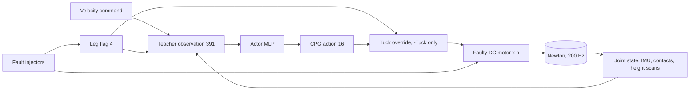

# A2 leg guard

**Gym IDs:** `IsaacContrib-Velocity-A2LegGuard-{Soft,Tuck}`
**Base:** `velocity/a2_velocity` `A2RobustTeacherEnvCfg` (env), `A2RobustTeacherPPORunnerCfg` (runner) ·
**Copied from:** the fault setup of `velocity/a2_fault_aware` · **Sources:** the argument of 2026-11-07 (per-leg signal instead of a failure taxonomy); Miki et al. 2022 for the base.

## 1. Summary

The robust teacher's task with motor faults and stuck feet and a 4-d leg flag in its input. While a leg is flagged,
the policy must stop relying on it: `-Soft` pays for the load on the flagged foot and finds its own way to unload it,
`-Tuck` has the action term pull the foot back, so the policy only has to balance on the other three.

## 2. Architecture

| Module | Rate [Hz] | Input → output | Notes |
|---|---|---|---|
| Policy | 50 | $o_t$ (395) $\to a_t$ (16) | teacher input + flag |
| Flag | 50 | injector schedule → 4 | training; in deployment `scripts/forge/leg_guard/guard_eval.py` writes `env.leg_flag` |
| Actuator | 200 | $q^{\ast}, q, \dot q \to \tau$ | DC motor scaled by health $h$ (`forge/fault_injector`) |

**Networks.**

| Network | Input (dim) | Layers | Output (dim) | Trained by |
|---|---|---|---|---|
| Actor | `policy` (395) | MLP [512, 256, 128], ELU | $\mu, \sigma$ (16) | PPO, from `a2_fault_aware` Blind |
| Critic | `policy` (395) | MLP [512, 256, 128], ELU | $V$ (1) | PPO, from `a2_fault_aware` Blind |

## 3. Method

Only what differs from the robust teacher.

### 3.1 Observations

| Group | Term | Definition | Dim |
|---|---|---|---|
| `policy` | `leg_flag` | $f \in \{0,1\}^4$, legs FL, FR, RL, RR | 4 |

A motor fault or a stuck foot sets the flag of its leg $\ell \sim U[0.1, 0.5]$ s after the onset (the detection study's
latency: median 0.16–0.22 s, p90 0.66 s), for as long as the fault lasts; in 15 % of the episodes it is missed. In 30 %
of the episodes a phantom alarm flags a random leg for $U[1, 3]$ s from $U[1, 15]$ s on; a true alarm overrides it.

### 3.2 Rewards

$r_{load} = -2 \sum_l f_l \min(\|F_l\| / F_0, 2)$ with $F_0$ = 98.3 N, A2's weight on four feet.

### 3.3 Actions (`-Tuck`)

While flagged, the targets of leg $l$ blend in 0.1 s to the hip's default angle and the IK solution 0.12 m above the
nominal stance position; the policy's action on that leg is ignored.

### 3.4 Events

As `a2_fault_aware`: `motor_fault` ($p = 0.4$, one joint, power out or loss $h \sim U[0.1, 0.6]$, onset $U[2, 8]$ s),
`foot_stuck` ($p = 0.4$, own seed 7919). Curriculum factor fixed at 1.

### 3.5 Training

From `a2_fault_aware` Blind `model_3998.pt`: `pad_checkpoint.py --drop 12 --extra 4` removes the 12 zero mode columns
and adds 4 zero flag columns, so the fine-tune starts from Blind's behavior; 1000 iterations.

## 4. Deviations

* The flag's distribution is chosen here, not measured on the final detector (the policy's gait changes the detector's
  input, so it cannot be measured before training).
* A permanent motor fault keeps its leg flagged to the end of the episode.
* A power-out joint cannot follow the tuck target; the other joints of the leg still do.
* Open: 2 of 6 training runs died with NaN observations (cause not found), so long runs may need a restart.

## 5. Results

`results/reports/leg_guard/20261107_leg_signal/REPORT.md`. In short: both variants unload the flagged leg, and neither
lowers falls against the same policy without a flag.

## 6. Changelog

2026-11-07: task created.
