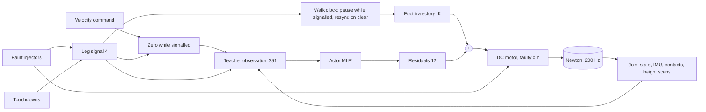

# A2 soft step

**Gym ID:** `IsaacContrib-Velocity-A2SoftStep`
**Base:** `velocity/a2_velocity` `A2RobustTeacherEnvCfg` (env), `A2RobustTeacherPPORunnerCfg` (runner) ·
**Copied from:** the CPG action of `velocity/a2_velocity/mdp/actions.py`; the leg flag and discrete contact penalty of
`velocity/a2_leg_guard/mdp/leg_flag.py` · **Sources:** the user's request of 2026-11-07; Miki et al. 2022 for the base.

## 1. Summary

A walking policy that never trusts a new foot at once. Each touchdown starts a loading time $T$ = 0.25 s in which the
new foot's load may only rise linearly to the full load $F_0$, so the other three feet must carry the robot. The gait
is a four-beat walk with a four-foot pause of $T$ after each touchdown. If a leg is signalled (a detector alarm,
here simulated), the policy takes that foot's load off at once and stands on the other three; while the signal is on,
the command reads zero, so standing still earns the tracking reward. When the signal clears, the walk resumes with
that leg's swing.

## 2. Architecture

| Module | Rate [Hz] | Input → output | Notes |
|---|---|---|---|
| Policy | 50 | $o_t$ (395) $\to a_t$ (12) | teacher input + signal |
| Walk clock + IK | 50 | phase (4) → nominal targets (12) | $q^{\ast} = \mathrm{IK}(p_l(\phi_l)) + 0.25\,a$ |
| Signal | 50 | touchdowns, injector labels → 4 | training event `leg_signal`; in deployment written to `env.leg_flag` from outside |
| Actuator | 200 | $q^{\ast}, q, \dot q \to \tau$ | DC motor scaled by health $h$ (`forge/fault_injector`) |

**Networks.**

| Network | Input (dim) | Layers | Output (dim) | Trained by |
|---|---|---|---|---|
| Actor | `policy` (395) | MLP [512, 256, 128], ELU | $\mu, \sigma$ (12) | PPO, from scratch |
| Critic | `policy` (395) | MLP [512, 256, 128], ELU | $V$ (1) | PPO, from scratch |

## 3. Method

Only what differs from the robust teacher.

### 3.1 Gait (`mdp/gait.py`)

Leg phases $\phi_l \in [0, 2\pi)$ advance at $2\pi f$ with $f = 1 / (4 (T_{sw} + T))$, $T_{sw}$ = 0.25 s,
$T$ = 0.25 s: a 2 s cycle. Leg $l$ swings while $\phi_l < 2\pi T_{sw} / (4(T_{sw}+T)) = \pi/4$; the legs are spaced
by $\pi/2$ in the order RL, FL, RR, FR, so one leg swings, then all four stand for $T$, then the next swings.
There is no phase action (the teacher's 4 phase offsets): the policy outputs the 12 residuals only, and the
`cpg_phase` observation's phase-action part is zero.

While a leg is signalled, the clock stops: stance legs hold, another leg's swing runs on to its touchdown, the
signalled leg holds wherever it is. When the signal clears, $\phi \leftarrow (\phi^{0} - \phi^{0}_{l}) \bmod 2\pi$ with
$\phi^0$ the walk pattern and $l$ the signalled leg: the walk restarts with $l$'s swing.

### 3.2 Signal (`mdp/signal.py`)

$s \in \{0,1\}^4$, `env.leg_flag`, observed as `leg_flag` (4). In training (event `leg_signal`, every step):

* Random: at each touchdown, with $p$ = 0.02, that foot is signalled after $U[0, T]$ (inside its loading time) for
  $U[1, 3]$ s; one signal at a time. About 40 touchdowns per 20 s episode, so about 0.8 per episode.
* Injectors: a motor fault ($p$ = 0.25, power out or loss) or a stuck foot ($p$ = 0.25) signals its leg
  $U[0.1, 0.5]$ s after onset (missed in 15 % of episodes), as long as the fault lasts; it overrides a random one.

### 3.3 Command

$v^{cmd} \sim U$: $v_x \in [-0.2, 0.2]$, $v_y \in [-0.1, 0.1]$ m/s, $\omega_z \in [-0.4, 0.4]$ rad/s (teacher ±1).
The command reads $v^{cmd} \cdot \mathbb{1}[\sum_l s_l = 0]$: zero while signalled, so the teacher's saturated tracking
terms reward standing still. Tracking std: teacher's $\sqrt{s_{A2}}$ × 0.2 (linear, orthogonal) and × 0.4 (yaw).

### 3.4 Rewards

| Term | Definition | Weight [1/s] |
|---|---|---|
| `load_ramp` | $\sum_{l: s_l=0,\ \tau_l < T} \min(\max(F_{z,l} - \frac{\tau_l}{T} F_0, 0)/F_0,\ 2)$, $\tau_l$ contact time | −2.0 |
| `flagged_foot_contact` | $\sum_l s_l\, \mathbb{1}[F_{z,l} > 5\,\mathrm{N}]\,(1 + \min(F_{z,l}/F_0, 2))$ | −1.5 |
| `termination` | 1 on a fall (not a time-out) | −200 |

$F_0 = m g / 4$ = 98.3 N. `flagged_foot_contact` costs 1.5–4.5 per second, about what the three tracking terms pay at
best; `termination` makes a fall cost more than a touch.

### 3.5 Terrain

Teacher terrain without the level curriculum: at 0.2 m/s a 20 s episode cannot cross half a tile (4 m), so
distance-based promotion would never fire. Robots stay at their initial levels 0–5.

### 3.6 Without the CPG (`-NoCPG`)

`IsaacContrib-Velocity-A2SoftStep-NoCPG` (`A2SoftStepNoCpgEnvCfg`) uses the same rewards, signal, faults, command and
terrain, with these changes:

* **Action.** Joint position offsets, $q^* = q_0 + 0.25\,a$ (12), as the A2 base task. There is no gait clock and no
  pause on a signal; the policy finds its own gait.
* **Observation.** It drops `cpg_phase`, `joint_target` and `joint_pos_error` (they read CPG-only attributes) and adds
  `last_action` (12).
* **Smoothness reward.** `target_smoothness` becomes `action_rate_l2` at −0.005. It keeps the same name, so the
  curriculum still scales it.
* **Termination.** `base_low` ends the episode when the base is less than $0.5 \times 0.385$ m above the mean terrain
  height under it, measured by the height scanner. This was added because `soft_s0` learned to lie belly down with all
  four feet at 0 N: no foot penalty, a level base, and no `base_link` contact reported.

### 3.7 Body-contact termination (`-BodyContact`)

`IsaacContrib-Velocity-A2SoftStep-BodyContact` (`A2SoftStepBodyContactEnvCfg`) is the CPG task of §3.1–3.5. It
replaces `base_contact`, which covered `base_link` only, with `body_contact`: the episode ends when any link other
than a foot (`^(?!.*_foot$).*`) has a contact force above 1 N. The user set this rule after `soft_s0`. A calf that
brushes a stair edge also ends the episode.

## 4. Deviations

* $T_{sw}$ = 0.25 s, $p$ = 0.02, hold $U[1, 3]$ s, fault probabilities 0.25 and the weights are chosen here.
* A permanent motor fault keeps its leg signalled, so the robot stands to the end of the episode.
* A power-out joint cannot lift its foot; the policy can still shift the weight off it.
* No lift-height term: a foot hovering just above the ground pays nothing.

## 5. Results

`results/reports/soft_step/`.

## 6. Changelog

2026-11-07: task created.

2026-11-07: `-NoCPG` variant (§3.6) with the `base_low` termination, after `soft_s0` lay belly down.

2026-11-07: `-BodyContact` variant (§3.7), the user's non-foot contact termination on the CPG task.
